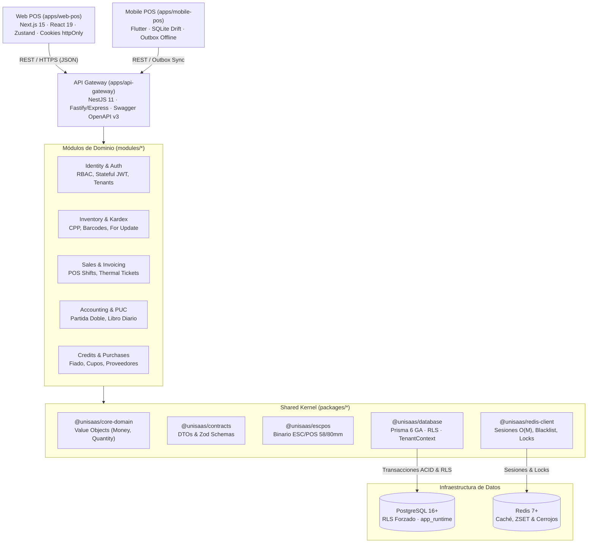

# UniSaaS — Monorepo de Punto de Venta (POS) y Gestión Contable Multi-Tenant

> **Plataforma Integral de Punto de Venta (POS), Facturación, Control de Inventarios y Contabilidad PUC Multi-Inquilino de Alta Concurrencia.**

---

## 1. Visión General de la Arquitectura

UniSaaS está diseñado como un **Monolito Modular** de alto rendimiento con arquitectura limpia (*Ports & Adapters* / Hexagonal), gestionado mediante **Turborepo** y **pnpm workspaces**. Proporciona una solución robusta para comercios minoristas, cadenas comerciales y distribuidoras en Colombia y Latinoamérica.



---

## 2. Estructura del Monorepo

```
unisaas/
├── apps/
│   ├── api-gateway/         # Backend monolítico modular NestJS 11 (Puerto 3000)
│   ├── web-pos/             # Frontend Web POS Next.js 15 / React 19 (Puerto 3001)
│   ├── mobile-pos/          # Cliente Móvil POS Flutter con arquitectura Offline-First
│   └── qa-e2e/              # Suite de pruebas E2E, certificación RLS y benchmarks k6
├── modules/
│   ├── identity/            # Autenticación, RBAC, gestión de inquilinos y planes
│   ├── inventory/           # Catálogo, existencias, movimientos kardex CPP y bodegas
│   ├── sales/               # Facturación POS, turnos de caja y comprobantes
│   ├── accounting/          # Plan Único de Cuentas (PUC) y asientos de partida doble
│   └── credits/             # Cartera fiado, compras a proveedores y cuentas por pagar
├── packages/
│   ├── core-domain/         # Value Objects (Money, Quantity, UUID) con precisión decimal.js
│   ├── contracts/           # DTOs canónicos y esquemas Zod de validación transversal
│   ├── escpos/              # Generador binario nativo de tickets térmicos ESC/POS (58/80mm)
│   ├── redis-client/        # Cliente Redis con sesiones O(M), blacklist y cerrojos atómicos
│   ├── database/            # Esquema modular Prisma 6 GA, migraciones y helper withTenantContext
│   └── config/              # Configuraciones base de TypeScript, ESLint y Prettier
├── docs/
│   ├── migration/           # Trazabilidad completa, decisiones ADR y matriz de migración
│   ├── legacy/              # Documentación histórica archivada de squads
│   └── openapi.json         # Especificación canónica OpenAPI v3
├── scripts/                 # Herramientas de despliegue, métricas y automatización
├── .env.example             # Plantilla canónica de variables de entorno seguras
├── ecosystem.config.cjs     # Configuración de procesos PM2 para producción
├── iniciar-unisaas.ps1      # Script maestro de arranque operativo en Windows
└── detener-unisaas.ps1      # Script de detención limpia de servicios
```

---

## 3. Matriz Tecnológica Estandarizada

| Componente | Versión | Propósito / Justificación |
| :--- | :--- | :--- |
| **Node.js** | `v26.13.0` (Host) / `^24.0.0 \|\| ^26.0.0` | Node.js LTS activo. Alto rendimiento en V8. |
| **pnpm** | `12.16.1` | Gestor de paquetes con aislamiento estricto y resolución determinista. |
| **Turborepo** | `2.11.10` | Pipeline de compilación y orquestación con caché inteligente. |
| **TypeScript** | `5.9.3` | Tipado estático unificado al 100% en todo el espacio de trabajo. |
| **NestJS** | `11.0.x` | Framework de backend estructurado por módulos de dominio. |
| **Next.js** | `15.x` (React 19) | Frontend Web POS moderno con App Router y cookies seguras httpOnly. |
| **Prisma ORM** | `6.19.3` (GA) | Persistencia modular con `prismaSchemaFolder` nativo. |
| **Flutter / Dart** | `3.38.5` / `3.10.4` | Aplicación móvil multiplataforma con base de datos local SQLite (Drift). |
| **PostgreSQL** | `16.x` / `17.x` | Base de datos relacional con Row Level Security (RLS) mandatorio. |
| **Redis** | `7.x` | Almacén en memoria para sesiones en tiempo $O(M)$ y cerrojos distribuidos. |

---

## 4. Requisitos Previos e Instalación

### Requisitos del Sistema
- **Node.js** `>= 24.0.0` o `>= 26.0.0`
- **pnpm** `>= 9.0.0` (se recomienda `pnpm@12.16.1`)
- **Docker** y **Docker Compose**
- **Flutter SDK** `>= 3.24.0` (para desarrollo móvil)

### Paso 1: Clonar y Configurar Entorno

```powershell
# Copiar plantilla de variables de entorno
Copy-Item .env.example .env

# Instalar dependencias deterministas en todo el monorepo
pnpm install
```

### Paso 2: Iniciar Servicios de Infraestructura

```powershell
# Iniciar contenedores de PostgreSQL 16 y Redis 7
docker compose up -d
```

### Paso 3: Inicializar Base de Datos y Prisma

```powershell
# Validar esquemas modulares de Prisma
pnpm db:validate

# Generar cliente tipado de Prisma
pnpm db:generate

# Aplicar migración DDL inicial (con RLS y rol app_runtime)
pnpm --filter @unisaas/database exec prisma migrate deploy
```

---

## 5. Ejecución del Sistema

### Modo Desarrollo

```powershell
# Iniciar todos los paquetes y aplicaciones con Turborepo
pnpm dev

# O arrancar con PM2 mediante el script automatizado:
.\iniciar-unisaas.ps1
```

* **API Gateway (NestJS):** [http://localhost:3000](http://localhost:3000)
* **Documentación Swagger / OpenAPI:** [http://localhost:3000/api/docs](http://localhost:3000/api/docs)
* **Web POS (Next.js):** [http://localhost:3001](http://localhost:3001)

### Detener Servicios

```powershell
.\detener-unisaas.ps1
```

### Compilación para Producción

```powershell
# Compilar todos los paquetes compartidos, módulos y aplicaciones web
pnpm build
```

---

## 6. Modelo de Seguridad Multi-Tenant y RLS

UniSaaS implementa una estrategia de **Aislamiento Multi-Tenant de Triple Blindaje**:

1. **Row Level Security (RLS) Mandatorio:**
   Todas las tablas de negocio incluyen la columna `tenant_id` y tienen aplicadas directivas `ENABLE ROW LEVEL SECURITY` y `FORCE ROW LEVEL SECURITY`. Ni siquiera los propietarios de tabla pueden eludir el aislamiento.
2. **Separación Estricta de Privilegios (`app_runtime`):**
   El código en tiempo de ejecución se conecta a PostgreSQL usando un rol con privilegios mínimos (`NOSUPERUSER`, `NOCREATEROLE`, `NOINHERIT`, `NOBYPASSRLS`).
3. **Transaccionalidad Exclusiva (`withTenantContext`):**
   Toda operación con la base de datos se ejecuta dentro de una transacción interactiva de PostgreSQL que establece variables locales acotadas a la sesión transaccional:
   ```sql
   SET LOCAL ROLE app_runtime;
   SET LOCAL app.current_tenant_id = '<tenant-uuid>';
   ```
   Al finalizar o abortar la transacción, PostgreSQL revierte automáticamente el contexto de seguridad, eliminando cualquier riesgo de contaminación en el pool de conexiones físicas.

4. **Secuencias Atómicas y Ordinales (`TenantSequence`):**
   La generación de consecutivos de facturas POS y asientos de libro diario utiliza bloqueos exclusivos a nivel de fila mediante `INSERT ... ON CONFLICT DO UPDATE RETURNING current_value`. Garantiza correlatividad estricta sin duplicados ni saltos bajo concurrencia masiva.

---

## 7. Ejecución de Pruebas y Certificación de Calidad

```powershell
# 1. Pruebas unitarias de todo el monorepo (Turborepo)
pnpm test

# 2. Pruebas de integración RLS contra PostgreSQL real
pnpm --filter @unisaas/database test

# 3. Pruebas unitarias del Web POS (Next.js)
pnpm --filter @unisaas/web-pos test

# 4. Pruebas unitarias y de integración offline del Mobile POS (Flutter)
cd apps/mobile-pos
flutter test test/offline_sync_scenarios_test.dart test/backend_contract_test.dart test/sale_payload_test.dart test/mobile_navigation_audit_test.dart test/widget_test.dart

# 5. Pruebas E2E de Aislamiento, Idempotencia y Secuencias Atómicas
cd ../qa-e2e
pnpm test:e2e
```

---

## 8. Licencia y Derechos

Propiedad confidencial de UniSaaS. Todos los derechos reservados.

