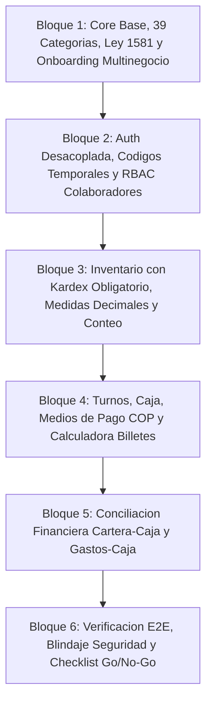

# PLAN MAESTRO DE DEPURACION E IMPLEMENTACION SECUENCIAL POR BLOQUES
## UniSaaS Colombia — POS, Inventario y Gestion Comercial

**Version:** 3.0.0-COLOMBIA-STANDARDS  
**Fecha:** 19 de octubre de 2026  
**Ecosistema:** UniSaaS (Squads 1 a 8)  
**Marco Rector:** `CHECKLIST_UNISAAS_CO.md`  
**Politica Obligatoria:** Cero Emojis | Cero Dependencias de IA | Aislamiento RLS | Moneda COP y Zona America/Bogota  

---

## 1. EQUIPO MULTIAGENTE DEV SENIOR ASIGNADO

Para la ejecucion coordinada de cada bloque se establece la siguiente estructura de roles tecnicos:

| Rol Virtual Asignado | Responsabilidades Principales | Enfoque Tecnico |
|---|---|---|
| **Dev Backend Core & Auth Senior** | Arquitectura de datos, RLS, NestJS, JWT, RBAC, servicios de autenticacion sin email, transacciones atomicas, APIs REST tipadas. | NestJS, TypeORM, Prisma, PostgreSQL 16, Crypto nativo, Zod. |
| **Dev Frontend POS & UI Senior** | Interfaces de usuario de mostrador POS, administracion Invo, modales, componentes tactiles, calculadora de billetes COP, responsive drawer. | Next.js 15 (App Router), Tailwind CSS, Lucide Icons, Web Audio API, React Hooks. |
| **Dev QA / Tester Senior** | Diseno y ejecucion de suites de pruebas unitarias, integracion transaccional con reversiones (ROLLBACK), mocks de prueba y simulaciones de estres. | Jest, Supertest, k6, React Testing Library. |
| **Dev DevOps & Seguridad Senior** | Auditoria contra vulnerabilidades OWASP (BOLA, IDOR, CSV Injection, XSS), saneamiento de secretos, politicas RLS, respaldos DR y Ley 1581. | Docker, PostgreSQL RLS, Scripts PowerShell/Bash, OpenSSL, CSP. |

---

## 2. MAPA SECUENCIAL DE BLOQUES ATOMICOS

---

## 3. ESPECIFICACION DETALLADA DE BLOQUES

---

### BLOQUE 1: Core Base, 39 Categorias Comerciales de Colombia, Habeas Data Ley 1581 y Onboarding Multinegocio

- **Multiagentes Responsables:**
  - *Lider Backend:* Dev Backend Core & Auth Senior
  - *Lider Frontend:* Dev Frontend POS & UI Senior
  - *Auditor QA & Seguridad:* Dev QA / Tester Senior & Dev DevOps & Seguridad Senior
- **Objetivos de Alcance:**
  1. **Expansion a los 39 Rubros Oficiales de Colombia:** Reemplazar el catalogo reducido de 7 categorias en `squad1/.../commercial-category.entity.ts` y `squad4/.../commercial-categories/route.ts` por los 39 rubros del comercio colombiano clasificados por familias (Retail, Gastronomia, Moda, Salud, Servicios, Especializado, Entretenimiento, Agropecuario) mas la opcion universal "Otro".
  2. **Tipos de Documento Colombiano:** Extender el selector de documentos en `src/app/register/page.tsx` para soportar CC, NIT (con algoritmo de calculo automatico de Digito de Verificacion), CE, TI, Pasaporte y PPT.
  3. **Consentimiento Explicito Ley 1581 de 2012:** Agregar en el Paso 3 del onboarding la casilla obligatoria de aceptacion de politicas de tratamiento y proteccion de datos personales.
  4. **Modelo Multinegocio para Propietarios (+ Agregar otro negocio):** Permitir que un usuario con rol `OWNER` registre y conmute entre multiples comercios aislados en base de datos sin requerir crear nuevas cuentas maestras.
  5. **Desacople de Restriccion Gmail:** Permitir registro con cualquier correo electronico corporativo o personal valido, manteniendo la sanitizacion estricta contra inyecciones.
- **Archivos a Intervenir:**
  - `squad1_core_architecture_rls_rbac-main/src/domain/entities/commercial-category.entity.ts`
  - `squad1_core_architecture_rls_rbac-main/src/application/services/tenants.service.ts`
  - `squad4_web_desktop_pos_nextjs-main/src/core/domain/models/commercial-categories.model.ts`
  - `squad4_web_desktop_pos_nextjs-main/src/app/api/commercial-categories/route.ts`
  - `squad4_web_desktop_pos_nextjs-main/src/app/api/auth/register/route.ts`
  - `squad4_web_desktop_pos_nextjs-main/src/app/register/page.tsx`
  - `squad4_web_desktop_pos_nextjs-main/src/app/admin/settings/page.tsx`
- **Criterios de Aceptacion y Pruebas QA:**
  - Suite de pruebas unitarias verificando que las 39 categorias mas "Otro" se serialicen y expongan sus capabilities correctamente.
  - Test de validacion del algoritmo de digito de verificacion (DV) para NITs colombianos.
  - Test de validacion que rechace el registro si no se acepta la politica de datos Ley 1581.
  - Registro de nuevo negocio en ceros ($0 ventas, 1 sucursal, 1 bodega, 1 caja) en tiempo menor a 500ms.

---

### BLOQUE 2: Autenticacion Desacoplada de Email, Codigos Temporales de Activacion y RBAC Estricto de Colaboradores

- **Multiagentes Responsables:**
  - *Lider Backend:* Dev Backend Core & Auth Senior
  - *Lider Frontend:* Dev Frontend POS & UI Senior
  - *Auditor QA & Seguridad:* Dev DevOps & Seguridad Senior
- **Objetivos de Alcance:**
  1. **Alta de Colaboradores sin Exigir Email:** Permitir al Propietario/Administrador en `/admin/team` crear colaboradores mediante un `username` unico (ej. `cajero.mocoa`, `bodega.juan`) y celular opcional.
  2. **Generacion y Almacenamiento de Codigo Temporal:** Emitir un codigo seguro alfanumerico de 6 a 8 caracteres de un solo uso con vencimiento a 24 horas, almacenado con hash bcrypt en base de datos/almacen.
  3. **Pantalla y Endpoint de Activacion (`/activar`):** Crear la interfaz publica para que el empleado digite su nombre de usuario, ingrese su codigo temporal y configure su contrasena definitiva segura.
  4. **Restablecimiento Manual de Acceso:** Opcion en `/admin/team` para que el Propietario revoque el acceso actual de un colaborador y genere un nuevo codigo temporal de activacion sin conocer su contrasena anterior.
  5. **Rol SUPERVISOR y Matriz RBAC Completa:** Incorporar explicitamente el rol `SUPERVISOR` en el selector de roles y matriz de permisos.
  6. **Revocacion Instantanea de Sesiones:** Invalidar inmediatamente el token de acceso y cerrar sesiones activas cuando un colaborador sea suspendido (`accountStatus === 'SUSPENDIDO'`).
- **Archivos a Intervenir:**
  - `squad1_core_architecture_rls_rbac-main/src/domain/entities/user.entity.ts`
  - `squad1_core_architecture_rls_rbac-main/src/application/services/users.service.ts`
  - `squad4_web_desktop_pos_nextjs-main/src/core/domain/models/role-rbac.model.ts`
  - `squad4_web_desktop_pos_nextjs-main/src/app/api/admin/team/route.ts`
  - `squad4_web_desktop_pos_nextjs-main/src/app/api/auth/activate/route.ts`
  - `squad4_web_desktop_pos_nextjs-main/src/app/activar/page.tsx`
  - `squad4_web_desktop_pos_nextjs-main/src/app/admin/team/page.tsx`
  - `squad4_web_desktop_pos_nextjs-main/src/middleware.ts`
- **Criterios de Aceptacion y Pruebas QA:**
  - Pruebas unitarias de emision, expiracion (24h) y canje exitoso de codigos temporales de activacion.
  - Prueba de proteccion contra fuerza bruta en canje de codigo (bloqueo tras 5 intentos fallidos).
  - Prueba de suspension de usuario: intento de invocar endpoints con token emitido previo a la suspension debe retornar HTTP 403 / 401.

---

### BLOQUE 3: Inventario con Kardex Obligatorio, Medidas Decimales y Auditoria de Conteo Fisico

- **Multiagentes Responsables:**
  - *Lider Backend:* Dev Backend Core Senior
  - *Lider Frontend:* Dev Frontend POS & UI Senior
  - *Auditor QA & Seguridad:* Dev QA / Tester Senior
- **Objetivos de Alcance:**
  1. **Trazabilidad Inmutable de Kardex en BFF:** Refactorizar `src/app/api/inventory/products/route.ts` para que la creacion de productos con stock inicial o cualquier ajuste de inventario genere obligatoriamente un registro en `stock_moves` (fecha/hora, tipo de movimiento, responsable, saldo anterior y saldo posterior).
  2. **Historial de Movimientos Kardex en UI:** Incorporar modal o pestaña de consulta cronologica de movimientos de inventario por articulo en `/admin/inventory`.
  3. **Medidas Decimales en Operacion:** Garantizar precision decimal de hasta 3 decimales para productos de pesaje (KG, LB) y longitud/volumen (METROS, LITROS).
  4. **Herramienta de Nuevo Conteo Fisico:** Implementar modal de toma de inventario fisico en `/admin/inventory`, comparando conteo real contra stock del sistema, exigiendo motivo de ajuste y asentando el movimiento automatico en Kardex.
  5. **Generador de Orden de Compra:** Generar orden de compra a proveedores para articulos en alerta de stock bajo con opcion de descarga y envio estructurado a WhatsApp.
- **Archivos a Intervenir:**
  - `squad4_web_desktop_pos_nextjs-main/src/app/api/inventory/products/route.ts`
  - `squad4_web_desktop_pos_nextjs-main/src/app/api/inventory/moves/route.ts`
  - `squad4_web_desktop_pos_nextjs-main/src/app/admin/inventory/page.tsx`
  - `squad4_web_desktop_pos_nextjs-main/src/core/domain/models/product.model.ts`
- **Criterios de Aceptacion y Pruebas QA:**
  - Verificacion de que ningun endpoint ejecute UPDATE directo sobre existencias sin registro correlativo en el Kardex.
  - Pruebas de ajuste por conteo fisico verificando conciliacion de saldos anteriores y posteriores.
  - Verificacion de calculo exacto de existencias fraccionarias con 3 decimales.

---

### BLOQUE 4: Turnos, Caja, Medios de Pago Colombianos y Calculadora de Billetes COP

- **Multiagentes Responsables:**
  - *Lider Frontend:* Dev Frontend POS & UI Senior
  - *Lider Backend:* Dev Backend Core Senior
  - *Auditor QA & Seguridad:* Dev DevOps & Seguridad Senior
- **Objetivos de Alcance:**
  1. **Eliminacion de Selector de Empleado no Autenticado:** Erradicar el `<select>` de cajero en `src/app/admin/balance/page.tsx`; vincular la apertura y cierre de caja estrictamente a la identidad autenticada del token de sesion.
  2. **Calculadora de Billetes y Monedas de Colombia:** Disenar e integrar el teclado/grilla de conteo por denominacion colombiana en apertura y cierre de caja:
     - Billetes: $ 100.000, $ 50.000, $ 20.000, $ 10.000, $ 5.000, $ 2.000.
     - Monedas: $ 1.000, $ 500, $ 200, $ 100, $ 50.
     - Calculo automatico en tiempo real del dinero total sin errores mentales.
  3. **Arqueo Ciego Configurable:** Opcion para ocultar el efectivo esperado del sistema al momento del cierre, forzando al cajero a contar y declarar el fisico real antes de contrastar descuadres.
  4. **Medios de Pago Colombianos en POS:** Incorporar en el mostrador `/pos` y en la pasarela manual de cobro: Bre-B (pago interoperable del Banco de la Republica con llave/QR), Transferencia directa y Otro.
- **Archivos a Intervenir:**
  - `squad4_web_desktop_pos_nextjs-main/src/app/pos/page.tsx`
  - `squad4_web_desktop_pos_nextjs-main/src/app/admin/balance/page.tsx`
  - `squad4_web_desktop_pos_nextjs-main/src/app/api/pos/shifts/route.ts`
  - `squad4_web_desktop_pos_nextjs-main/src/core/domain/models/cash-shift.model.ts`
- **Criterios de Aceptacion y Pruebas QA:**
  - Suite de pruebas unitarias verificando la precision aritmetica de la calculadora de denominaciones COP.
  - Pruebas de calculo de descuadre (sobrante, faltante, exacto) y generacion del reporte Z inmutable.
  - Prueba de checkout POS seleccionando Bre-B, Transferencia y verificacion en ticket termico.

---

### BLOQUE 5: Conciliacion Financiera Integral: Cartera (Abonos a Caja) y Gastos (Egresos de Caja)

- **Multiagentes Responsables:**
  - *Lider Backend:* Dev Backend Core Senior
  - *Lider Frontend:* Dev Frontend POS & UI Senior
  - *Auditor QA & Seguridad:* Dev QA / Tester Senior
- **Objetivos de Alcance:**
  1. **Impacto de Abonos de Cartera en Caja Abierta:** Cuando se registre un abono de cliente en Efectivo (`/api/credits/customers/[customerId]/payments`), sumar automaticamente el monto al turno de caja activo en el renglon de Abonos de Cartera y reflejarlo en el efectivo esperado.
  2. **Impacto de Gastos en Caja Abierta:** Cuando se cree un gasto operativo (`/api/accounting/expenses`) con origen `EFECTIVO_CAJA`, descontar automaticamente el valor del efectivo esperado en la caja en turno.
  3. **Calculadora Bidireccional de Compras:** Formulario de compras con calculo reactivo de Costo Total vs Costo Unitario con precision decimal.
  4. **Indicador Visual de Estado de Red (Offline Banner):** Banner flotante en `/pos` que notifique inmediatamente la perdida de conexion a internet sin emitir ventas falsas.
- **Archivos a Intervenir:**
  - `squad4_web_desktop_pos_nextjs-main/src/app/api/credits/customers/[customerId]/payments/route.ts`
  - `squad4_web_desktop_pos_nextjs-main/src/app/api/accounting/expenses/route.ts`
  - `squad4_web_desktop_pos_nextjs-main/src/app/admin/balance/page.tsx`
  - `squad4_web_desktop_pos_nextjs-main/src/app/admin/gastos/page.tsx`
  - `squad4_web_desktop_pos_nextjs-main/src/app/pos/page.tsx`
- **Criterios de Aceptacion y Pruebas QA:**
  - Verificacion de formula: `Efectivo Esperado = Base + Ventas Efectivo + Abonos Efectivo - Gastos Efectivo`.
  - Prueba de conciliacion exacta al centavo/peso entre modulo de Balance, Cartera, Gastos y Arqueo de Caja.

---

### BLOQUE 6: Verificacion E2E Integral, Blindaje de Seguridad y Criterios Go/No-Go

- **Multiagentes Responsables:**
  - *Lider QA:* Dev QA / Tester Senior
  - *Lider Seguridad & DevOps:* Dev DevOps & Seguridad Senior
  - *Integrador:* Director de Tecnologia (CTO)
- **Objetivos de Alcance:**
  1. **Suite E2E Automatizada de Flujo Completo:** Probar el ciclo de vida comercial completo desde el registro del comercio con las 39 categorias hasta el cierre de turno con arqueo de billetes y exportacion de balance.
  2. **Auditoria de Seguridad y Privacidad:** Verificacion de politicas RLS, prueba negativa de IDOR/BOLA entre comercios, confirmacion de 0% IA y Ley 1581.
  3. **Certificacion Final de Criterios Go/No-Go:** Actualizacion definitiva de `CHECKLIST_UNISAAS_CO.md` y emision del reporte de certificacion para lanzamiento piloto.
- **Archivos a Intervenir:**
  - `squad4_web_desktop_pos_nextjs-main/src/__tests__/colombia-e2e-master-audit.test.ts`
  - `CHECKLIST_UNISAAS_CO.md`
  - `IMPLEMENTATION_STATUS_UNISAAS.md`
  - `MANUAL_ARRANQUE_Y_COMANDOS_UNISAAS.md`
- **Criterios de Aceptacion y Pruebas QA:**
  - 100% de pruebas passing en todas las suites de los squads.
  - Cero errores en compilacion de produccion (`next build`).
  - Reporte ejecutivo de salida aprobado.

---

## 4. MATRIZ DE ASIGNACION DE RESPONSABILIDADES (RACI)

| Bloque | Dev Backend Core | Dev Frontend POS/UI | Dev QA / Tester | Dev DevOps / Seguridad |
|---|---|---|---|---|
| **Bloque 1** (Categorias, Ley 1581, Onboarding) | **R**esponsable | **R**esponsable | **C**onsultado | **A**probador |
| **Bloque 2** (Auth sin Email, Codigo Temporal, RBAC) | **R**esponsable | **R**esponsable | **A**probador | **A**probador |
| **Bloque 3** (Kardex, Decimales, Conteo Fisico) | **R**esponsable | **R**esponsable | **A**probador | **C**onsultado |
| **Bloque 4** (Turnos, Billetes COP, Bre-B, Medios) | **R**esponsable | **R**esponsable | **A**probador | **C**onsultado |
| **Bloque 5** (Conciliacion Cartera/Gastos/Caja) | **R**esponsable | **R**esponsable | **A**probador | **C**onsultado |
| **Bloque 6** (E2E Master, Auditoria, Go/No-Go) | **I**nformado | **I**nformado | **R**esponsable | **R**esponsable |
