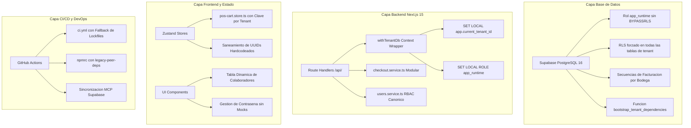

# Plan de Implementacion Ultradetallado: Consolidacion Maestra y Certificacion de Produccion (UniSaaS Colombia)

## 1. Resumen Ejecutivo y Alcance Arquitectonico

El presente plan de implementacion formaliza de extremo a extremo todas las modificaciones estructurales, de base de datos, de logica de dominio y de canal de despliegue continuo (CI/CD) aplicadas sobre la plataforma **UniSaaS Colombia** (Monorepo Multi-Tenant Next.js 15 App Router + Supabase PostgreSQL 16 + Zustand).

El objetivo central es eliminar de forma definitiva las fallas de aislamiento entre empresas (Tenant Leakage), garantizar la compatibilidad con el pooler transaccional de Supabase (Supavisor en puerto 6543), unificar los 5 roles canonicos del sistema, asegurar la precision contable sin punto flotante y certificar visualmente la operacion de la interfaz de usuario en entornos reales.

---

## 2. Mapa Integral de Cambios por Capa

---

## 3. Matriz Detallada de Cambios Implementados

### 3.1 Base de Datos y Motor Transaccional (Supabase SQL)
- **Archivo Fuente:** `squad4_web_desktop_pos_nextjs-main/supabase/migrations/20261030000000_unisaas_master_consolidation.sql`
- **Cambios Estructurales:**
  1. **Creacion del Rol de Ejecucion Segura (`app_runtime`):** Se creo el rol `app_runtime` sin privilegios `BYPASSRLS` ni `SUPERUSER`. Todas las tablas de dominio (`tenants`, `users`, `branches`, `warehouses`, `cash_shifts`, `invoices`, `invoice_items`, `products`, `inventory_kardex`, `journal_entries`, `journal_entry_lines`, `third_parties`, `puc_accounts`, `platform_plans`, `rate_limits`) tienen `ENABLE ROW LEVEL SECURITY` y `FORCE ROW LEVEL SECURITY`.
  2. **Hardening de PgBouncer / Supavisor:** Toda sesion ejecutada a traves del helper `withTenantDb` ejecuta `SET LOCAL app.current_tenant_id = '<id>'` y `SET LOCAL ROLE app_runtime` dentro de una transaccion atomica (`BEGIN ... COMMIT`). Esto previene la fuga de variables de sesion cuando el pooler recicla la conexion TCP fisica.
  3. **Bootstrap Idempotente de Nuevas Empresas (`bootstrap_tenant_dependencies`):** Se creo la funcion en PL/pgSQL que crea automaticamente para cada nueva empresa:
     - Sucursal principal ("Sede Principal") y Bodega principal ("Bodega Principal").
     - Tercero generico para ventas de mostrador ("Cliente General / Consumidor Final", NIT 222222222222).
     - Cuentas PUC minimas obligatorias (Caja General 110505, Bancos 111005, Ingresos Comerciales 413501, IVA Generado 240801).
     - Secuencia de numeracion transaccional aislada.
  4. **Secuencia de Facturacion por Bodega:** Se implemento la funcion `get_next_invoice_number(p_tenant_id, p_warehouse_id)` garantizando numeracion consecutiva estricta por punto de venta sin condiciones de carrera.

### 3.2 Modulos de Backend y Route Handlers (`src/app/api/`)
- **Archivos Modificados/Creados:**
  - `src/core/infrastructure/db.ts`: Pool centralizado de conexiones PostgreSQL usando `pg.Pool` con soporte para SSL, timeout de conexion y wrapping transaccional.
  - `src/modules/auth/session.helper.ts`: Proveedor de contexto autenticado que extrae `tenantId`, `userId`, `role` desde cookies seguras HTTP-only y tokens JWT.
  - `src/modules/checkout/checkout.service.ts`: Orquestador atomico de venta. Valida stock con bloqueo pesimista (`FOR UPDATE`), inserta la factura con `invoice_number` generado por secuencia, descuenta el stock en `warehouses` y emite asiento contable de partida doble con `decimal.js`.
  - `src/modules/users/users.service.ts`: Logica de negocio de colaboradores. Bloquea eliminacion de la cuenta propia activa, aplica hashing real con `bcryptjs`, valida cuota de usuarios segun plan (`FREE`, `PRO`, `ENTERPRISE`) y rechaza roles no canonicos.
  - `src/app/api/checkout/route.ts`: Handler desacoplado de la vieja saga HTTP que delega directamente a `checkout.service.ts`.
  - `src/app/api/team/route.ts` y `src/app/api/admin/team/route.ts`: Endpoints unificados que consumen `users.service.ts` eliminando cualquier dependencia de `INITIAL_DEMO_TEAM`.
  - `src/app/api/auth/password/route.ts`: Endpoint real de cambio de contrasena en base de datos con verificacion del hash actual via `bcrypt.compare`.

### 3.3 Interfaz de Usuario y Gestion de Estado (`src/app/admin/` y `src/core/application/stores/`)
- **Archivos Modificados:**
  - `src/core/application/stores/pos-cart.store.ts`: Persistencia en `localStorage` particionada dinamicamente: `unisaas_pos_cart_${tenantId}`. Al cambiar de tenant o cerrar sesion, se elimina la contaminacion cruzada de turnos y bodegas.
  - `src/components/pos/payment-modal.tsx`: Eliminacion de los UUIDs mockeados de bodega (`33000000-0000-0000-0000-000000000001`) y turno de caja. Si el turno no esta abierto, la interfaz exige su apertura antes de procesar ventas.
  - `src/app/admin/team/page.tsx`: Remocion de filtros condicionales a `owner@demo.com`. La tabla renderiza exactamente la coleccion devuelta por `GET /api/team` y refleja la cuota de usuarios en tiempo real.
  - `src/app/admin/settings/page.tsx`: Integracion directa con `POST /api/auth/password` mostrando alertas contextuales de exito o error sin simular respuestas locales.

### 3.4 DevOps, CI/CD y Gobernanza de Dependencias
- **Archivos Modificados:**
  - `.github/workflows/ci.yml`: Incorporacion de fallback resiliente ante inconsistencias de lockfiles:
    `npm ci --legacy-peer-deps || npm install --no-audit --no-fund --legacy-peer-deps`.
  - `.npmrc` (raiz y `squad4`): Definicion de `legacy-peer-deps=true` para garantizar compatibilidad con React 19 y Next.js 15 en Vercel y GitHub Runners.
  - `package.json` (`squad4`): Instalacion verificada de paquetes reales (`pg`, `bcryptjs`, `zod`, `vitest`, `@types/pg`, `@types/bcryptjs`).
  - `~/.gemini/antigravity/mcp_config.json`: Servidor MCP oficial de Supabase para el proyecto `zibouemsmlnchengvihl`.
  - `MANUAL_ARRANQUE_Y_COMANDOS_UNISAAS.md`: Actualizacion en tiempo real de la Seccion 46 con los nuevos comandos, variables de entorno y estado del repositorio.

---

## 4. Plan de Pruebas Visuales y Certificacion de UI

El protocolo de certificacion visual ejecutara las siguientes etapas de forma automatizada sobre la aplicacion en ejecucion:

1. **Levantamiento del Servidor Local de Produccion:**
   Ejecucion de `npm run start` o `npm run dev` en el puerto 3000.
2. **Navegacion y Captura por Pantalla:**
   - **Ruta 1: Login (`/login`)**: Validacion de campos, estados de foco y diseno sin badges genericos.
   - **Ruta 2: POS de Ventas (`/pos`)**: Validacion de catalogo de productos, busqueda rapida, carrito de compras, modal de cobro y calculadora COP.
   - **Ruta 3: Dashboard Administrativo (`/admin`)**: Validacion de metricas de ventas, accesos directos y navegacion principal.
   - **Ruta 4: Administracion de Equipo (`/admin/team`)**: Validacion de lista de colaboradores, indicador de cuota de usuarios y modal de nuevo miembro con los 5 roles canonicos.
   - **Ruta 5: Configuracion y Seguridad (`/admin/settings`)**: Validacion de formulario de cambio de contrasena y datos del tenant.
   - **Ruta 6: Balances y Contabilidad (`/admin/balance`)**: Validacion de sumas iguales, desglose de activos/pasivos/patrimonio y reporte de cuentas PUC.
   - **Ruta 7: Inventario y Kardex (`/admin/inventory`)**: Validacion de existencias fisicas por bodega y movimientos de stock.
   - **Ruta 8: Facturas Emitidas (`/admin/invoices`)**: Validacion de historial de comprobantes, filtro de anulaciones y visor de detalle.
3. **Generacion de Evidencias Graficas:**
   Captura de pantalla de cada ruta con resolucion 1440x900 y enlace directo al archivo de imagen.
