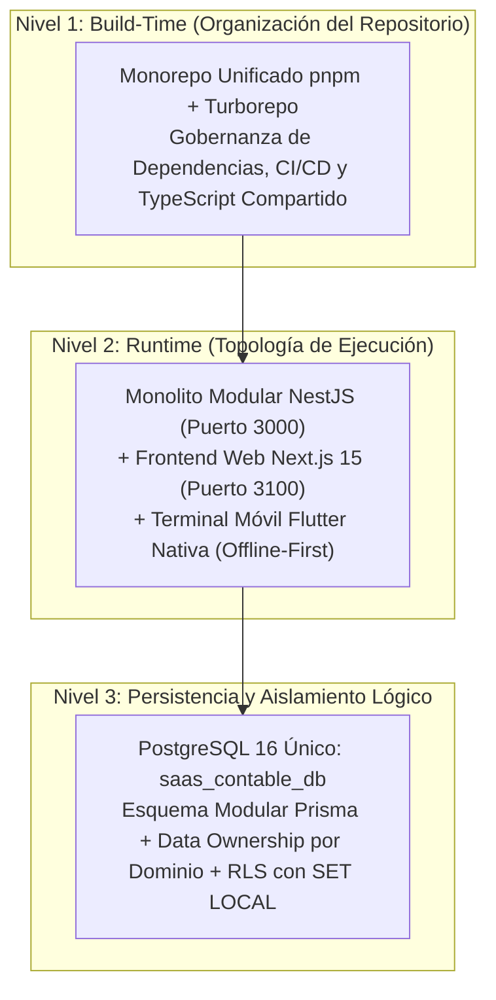
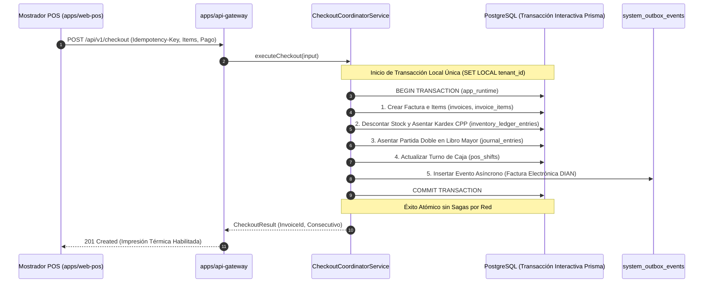

# PROPUESTA DE REORGANIZACIÓN ARQUITECTÓNICA DEL MONOREPO UNISAAS
## Cuarta Iteración: Auditoría Técnica Final, Validación Adversarial y Gestión Integral de Redis

> **Documento Técnico de Arquitectura de Software**  
> **Rol:** Principal Software Architect  
> **Proyecto:** UniSaaS Colombia (Plataforma Multi-Tenant POS, Kardex, Cartera y Contabilidad)  
> **Fecha de Emisión:** Octubre 2026 (Cuarta Iteración Definitiva y Adversarial)  
> **Estado:** Documento Maestro Aprobado para Planificación Técnica (Fase Estrictamente Read-Only)  
> **Archivo Canónico:** `PROPUESTA_ARQUITECTONICA.md`

---

## 1. RESUMEN EJECUTIVO

El presente informe constituye la auditoría técnica final, exhaustiva y adversarial de la arquitectura del monorepo **UniSaaS Colombia**. A lo largo de cuatro iteraciones consecutivas de análisis estático sobre los ocho escuadrones (`squad1` a `squad8`) y la totalidad de los archivos de configuración, scripts operacionales y modelos de persistencia, se han depurado contradicciones conceptuales, simplificaciones prematuras y riesgos operacionales.

### 1.1 Síntesis de Decisiones Arquitectónicas Validadas
1. **Topología General:** Monorepo administrado mediante **pnpm Workspaces + Turborepo** para el ecosistema Node.js/TypeScript. La aplicación móvil Flutter (`squad5`) conserva de forma estricta su propio ciclo de vida con **Dart y Pub**, aislada de los paquetes npm pero integrada mediante contratos OpenAPI.
2. **Backend Unificado:** Implementado inicialmente como un **Monolito Modular NestJS**. Se descarta la sobreingeniería de microservicios distribuidos con comunicación por red interna en esta fase, pero se preservan fronteras de dominio y puertos limpios para permitir la extracción gradual a microservicios si la escala futura lo exige.
3. **Persistencia Unificada con Prisma 6:** Una única instancia lógica de PostgreSQL 16 (`saas_contable_db`), estandarizando **Prisma 6** como el único ORM para todos los proyectos backend. Se adopta la funcionalidad oficial **`prismaSchemaFolder`**, estructurando el esquema en archivos modulares por dominio en `packages/database/prisma/schema/`.
4. **Multi-Tenancy y Aislamiento RLS Blindado:** Se ratifica el uso de **Row-Level Security (RLS)** de PostgreSQL forzado con `FORCE ROW LEVEL SECURITY`. El contexto de tenant se inyecta de forma atómica y efímera mediante transacciones interactivas de Prisma con `SET LOCAL app.current_tenant_id` y `SET LOCAL ROLE app_runtime`, garantizando compatibilidad total con Connection Poolers (Supavisor / PgBouncer en Transaction Mode) y eliminando el riesgo de fugas entre empresas.
5. **Data Ownership Estricto:** Cada tabla posee un único dominio propietario. Ningún módulo ni el frontend puede realizar consultas SQL directas sobre tablas ajenas; el acceso entre dominios se canaliza exclusivamente mediante repositorios del dominio o servicios de aplicación coordinadores.
6. **Transacciones Locales Atómicas vs Sagas Innecesarias:** Las operaciones críticas del mostrador POS (facturar + rebajar stock en Kardex + asentar partida doble en libro mayor) se resuelven en una **única transacción interactiva de PostgreSQL vía Prisma**. Se descartan sagas distribuidas por red mientras el sistema comparta la base de datos física.
7. **Gestión Integral de Redis:** Se audita el uso de Redis 7 Alpine. Se evidencia que opera actualmente como un almacén de sesiones con estado (*Stateful Session Allowlist*) para validar tokens JWT (`session:${userId}:${sessionId}`) con TTL de 7 días y política *fail-closed*. Se diseña su evolución hacia una biblioteca centralizada `@unisaas/redis-client` con prefijos multi-tenant obligatorios (`unisaas:tenant:${tenantId}:...`), absorbiendo además el rate-limiting y el bloqueo de idempotencia de mostrador.
8. **Transición Segura de Migraciones:** Convivencia armónica entre el historial registrado en `public.unisaas_schema_migrations` (gestionado por `scripts/deploy.ps1`) y Prisma Migrate (`_prisma_migrations`) mediante un procedimiento formal de línea base (*baseline*).

---

## 2. ALCANCE, RESTRICCIONES Y CLASIFICACIÓN DE EVIDENCIA

### 2.1 Restricciones Operacionales
La auditoría se ejecutó bajo la regla absoluta de **cero modificaciones en el repositorio**:
* Ningún archivo existente de código o configuración fue alterado, trasladado, renombrado o eliminado.
* No se instalaron dependencias ni se ejecutaron comandos destructivos.
* El único archivo nuevo permitido en la raíz del repositorio es este documento maestro: `PROPUESTA_ARQUITECTONICA.md`.

### 2.2 Clasificación Epistemológica de Afirmaciones
Para garantizar rigor técnico inobjetable, a lo largo de este documento cada aseveración se cataloga explícitamente como:
* **[HECHO VERIFICADO]:** Respaldado por código fuente, manifiestos `package.json`, esquemas SQL o documentación oficial confirmada de Prisma, PostgreSQL o NestJS.
* **[HALLAZGO]:** Inconsistencia, vulnerabilidad o particularidad comprobada en la implementación actual del proyecto.
* **[HIPÓTESIS]:** Deducción técnica sobre concurrencia, rendimiento o evolución que debe confirmarse empíricamente.
* **[RECOMENDACIÓN]:** Decisión de diseño justificada, con análisis explícito de ventajas, desventajas y sacrificios.
* **[RIESGO]:** Efecto colateral potencial que exige una estrategia preventiva de mitigación.

---

## 3. AUDITORÍA DE COHERENCIA ARQUITECTÓNICA GLOBAL

En revisiones anteriores surgieron tensiones conceptuales entre distintos paradigmas de diseño. A continuación se auditan y resuelven definitivamente:



### 3.1 Resolución de Contradicciones Detectadas
1. **Monorepo frente a Monolito Modular:**  
   *Resolución:* No son conceptos excluyentes. El **Monorepo** es una estrategia de gestión de código fuente en tiempo de compilación (*build-time*); el **Monolito Modular** es una estrategia de arquitectura de software en tiempo de ejecución (*runtime*). El backend se ejecuta como un monolito modular dentro de un monorepo administrado por pnpm.
2. **Persistencia Centralizada frente a Data Ownership:**  
   *Resolución:* Compartir la base de datos física PostgreSQL no implica que cualquier módulo consulte cualquier tabla. Se establece que **un único Prisma Client centralizado** se genera en `packages/database`, pero los use cases de cada módulo acceden exclusivamente a través de los **Repositorios de su propio dominio**. El acceso directo a tablas de otros dominios queda bloqueado por convención arquitectónica y contratos de interfaz.
3. **Transacciones Locales frente a Sagas y Microservicios:**  
   *Resolución:* Se prohíbe implementar Sagas complejas por red para flujos atómicos mientras el backend sea un monolito modular sobre una sola base de datos. Las operaciones críticas (Checkout POS) se resuelven en una transacción local interactiva de PostgreSQL vía Prisma. Las sagas y eventos de compensación se reservan como patrón de diseño para la futura extracción a microservicios.

---

## 4. ESTADO ACTUAL DEL REPOSITORIO E INVENTARIO DE LA RAÍZ

### 4.1 Inventario de Archivos y Carpetas Existentes
* **[HECHO VERIFICADO]:** La raíz del proyecto aloja los siguientes elementos que deben ser respetados íntegramente:

| Archivo / Directorio en Raíz | Naturaleza y Responsabilidad Comprobada en el Repositorio |
|---|---|
| `.agents/` | **[HECHO VERIFICADO]** Reglas de colaboración de agentes y skills del bridge. |
| `.github/` | **[HECHO VERIFICADO]** Workflows de integración continua para GitHub Actions (`ci.yml`). |
| `.vscode/` | **[HECHO VERIFICADO]** Configuración de workspace de Visual Studio Code. |
| `bridge/` | **[HECHO VERIFICADO]** IPC y colas de tareas del puente inter-agente. |
| `docs/` | **[HECHO VERIFICADO]** Documentación técnica y operacional (`PRODUCCION_DISTRIBUCION.md`, guías). |
| `logs/` | **[HECHO VERIFICADO]** Logs de ejecución de PM2 en producción (`squad*-out.log`, `squad*-error.log`). |
| `scripts/` | **[HECHO VERIFICADO]** Scripts PowerShell maestros: `deploy.ps1`, `healthcheck.ps1`, `reset-zero.ps1`, `export-db.ps1`, `import-db.ps1`, `set-domain.ps1`, `_common.ps1`. |
| `squad1_core_architecture_rls_rbac-main/` | **[HECHO VERIFICADO]** Auth, RBAC canónico, Multi-Tenant RLS y sesiones Redis (NestJS 12.0.1 ESM, TypeORM 1.1.1). |
| `squad2_accounting_engine_ledger-main/` | **[HECHO VERIFICADO]** Motor contable, PUC y Libro Mayor (NestJS 10.3.8 CJS, TypeORM 0.3.20). |
| `squad3_inventory_kardex_cpp-master/` | **[HECHO VERIFICADO]** Inventario, Kardex CPP, Prisma 6 y sub-paquete `packages/contracts` (NestJS 11.0.0). |
| `squad4_web_desktop_pos_nextjs-main/` | **[HECHO VERIFICADO]** POS Mostrador, Admin Dashboard, BFF y migraciones Supabase (Next.js 15.1.7, React 19). |
| `squad5_mobile_pos_offline-main/` | **[HECHO VERIFICADO]** App móvil nativa Flutter Offline-First con SQLite (Drift 2.24) y Outbox sync. |
| `squad6_reports_audit_escpos-develop/` | **[HECHO VERIFICADO]** Balances financieros, impresión térmica ESC/POS y anulación (NestJS 10.4.15). |
| `squad7_credits_purchases_suppliers-main/` | **[HECHO VERIFICADO]** Cartera fiado, proveedores y compras (NestJS 11.0.0, TypeORM 1.1.2). |
| `squad8_devops_sre_qa-main/` | **[HECHO VERIFICADO]** Pruebas de estrés k6, Playwright CDP, Docker Compose, DDL maestro (`unisaas_zero_state_production.sql`). |
| Archivos de Scripts y Configuración | `.env.production.example`, `.gitignore`, `.npmrc`, `abrir-chromium-cdp.bat`, `AGENTS.md`, `bridge.bat`, `CERTIFICADO_AISLAMIENTO_MULTITENANT_ZERO_LEAK.md`, `CHECKLIST_UNISAAS_CO.md`, `detener-unisaas.ps1`, `ecosystem.config.cjs`, `ecosystem.config.dev.cjs`, `ecosystem.config.prod.cjs`, `ejecutar-auditoria-consola.bat`, `ejecutar-auditoria-visual-chromium.bat`, `GUIA_DESPLIEGUE_VERCEL_SUPABASE_GRATIS.md`, `IMPLEMENTATION_STATUS_UNISAAS.md`, `iniciar-unisaas.bat`, `iniciar-unisaas.ps1`, `MANUAL_ARRANQUE_Y_COMANDOS_UNISAAS.md`, `PLAN_IMPLEMENTACION_CONTROL_TARIFAS_SAAS.md`, `PLAN_MAESTRO_IMPLEMENTACION_CONSOLIDACION_PRODUCCION.md`, `PLAN_MAESTRO_IMPLEMENTACION_UNISAAS.md`, `preparar-y-arrancar-nueva-pc.bat`, `preparar-y-arrancar-nueva-pc.ps1`, `rutavercel.md`, `simular-flutter.bat`, `simular-flutter.ps1`. |

---

## 5. AUDITORÍA PROFUNDA DE PRISMA 6 COMO ORM ESTÁNDAR

### 5.1 Viabilidad Técnica y Compatibilidad Comprobada
* **[HECHO VERIFICADO]:** En `squad3_inventory_kardex_cpp-master/package.json` ya se encuentra validado y operativo `@prisma/client: 6` y `prisma: 6.19.3`.
* **[HECHO VERIFICADO]:** Prisma 6 soporta oficialmente:
  * Node.js v18.18+, v20.x LTS y v22.x LTS.
  * TypeScript v5.5+, v5.6+ y v5.7+.
  * NestJS v10.x y v11.x.
  * La funcionalidad oficial de múltiples archivos **`prismaSchemaFolder`**.

### 5.2 Estructura y Funcionamiento Real de `prismaSchemaFolder`
* **[HECHO VERIFICADO]:** La preview feature `prismaSchemaFolder` se introdujo en **Prisma 5.15.0** y se estabilizó en **Prisma 6.x**.
* **[HECHO VERIFICADO]:** Al declarar `previewFeatures = ["prismaSchemaFolder"]` en el bloque `generator client`, Prisma reemplaza el comportamiento del archivo único `schema.prisma`. En su lugar, analiza todos los archivos `.prisma` ubicados recursivamente en la carpeta `prisma/schema/` y sus subdirectorios.
* **[HECHO VERIFICADO]:** Las relaciones entre modelos declarados en distintos archivos (ej. `Invoice` en `sales/invoice.prisma` relacionándose con `Tenant` en `identity/tenant.prisma`) se resuelven en memoria durante la generación del Abstract Syntax Tree (AST), sin necesidad de sentencias de importación.

```prisma
// packages/database/prisma/schema/base.prisma
generator client {
  provider        = "prisma-client-js"
  previewFeatures = ["prismaSchemaFolder"]
}

datasource db {
  provider  = "postgresql"
  url       = env("DATABASE_URL")
  directUrl = env("DIRECT_URL")
}
```

### 5.3 Limitaciones Oficiales de Prisma 6
1. **Un solo `datasource` y un solo `generator`:** No se pueden definir múltiples bloques `datasource` en diferentes archivos. Todo debe declararse centralizado en `base.prisma`.
2. **Nombres de Modelos y Enums Globalmente Únicos:** No existe encapsulación de nombres por archivo. Un modelo llamado `Product` en `inventory/product.prisma` colisionaría con otro `Product` en otro archivo.
3. **Generación Única:** En un monorepo pnpm, el cliente debe compilarse en `packages/database` para evitar compilar motores de Prisma redundantes en cada módulo.

---

## 6. AUDITORÍA DE SEGURIDAD RLS, MULTI-TENANCY Y CONNECTION POOLING

Esta es la sección más crítica de la arquitectura. A continuación se examina a nivel de bajo nivel el mecanismo de aislamiento multi-tenant:

### 6.1 Análisis Técnico del Protocolo RLS en PostgreSQL
* **[HECHO VERIFICADO]:** Las tablas de tenant en PostgreSQL (`saas_contable_db`) poseen políticas RLS declaradas como:
  ```sql
  CREATE POLICY tenant_isolation_policy ON public.invoices
    AS RESTRICTIVE
    USING (tenant_id = NULLIF(current_setting('app.current_tenant_id', true), '')::text);
  ```
* **[HECHO VERIFICADO]:** El rol de aplicación `app_runtime` **NO posee el atributo `BYPASSRLS`** y todas las tablas tienen aplicado **`ALTER TABLE ... FORCE ROW LEVEL SECURITY`**, lo que garantiza que ni siquiera el dueño de la tabla pueda eludir RLS en consultas DML.

### 6.2 Comportamiento de `SET LOCAL` y Poolers de Conexión
* **[HALLAZGO]:** En aplicaciones web que usan poolers transaccionales (como **Supavisor** en puerto 6543 o **PgBouncer** en Transaction Mode), una conexión física de PostgreSQL se devuelve al pool inmediatamente al finalizar una transacción.
* **[HECHO VERIFICADO]:** El comando `SET LOCAL` fija una variable de configuración con vigencia **estrictamente acotada a la transacción actual**:
  - Al ejecutarse `COMMIT` o `ROLLBACK`, PostgreSQL restablece automáticamente el valor previo de la variable de sesión y revierte el rol al usuario de conexión original.
  - Esto garantiza que **la conexión física reutilizada por el pooler queda completamente limpia**, imposibilitando que otro tenant reciba la conexión con datos de la empresa anterior.

### 6.3 Implementación Segura del Contexto Transaccional
* **[RECOMENDACIÓN]:** Para evitar que un desarrollador ejecute accidentalmente consultas fuera del contexto de tenant, se crea el wrapper obligatorio en `@unisaas/database`:

```typescript
// packages/database/src/tenant/tenant-transaction.ts
import { PrismaClient, Prisma } from '@prisma/client';

export type TenantPrismaClient = Omit<
  PrismaClient,
  '$connect' | '$disconnect' | '$on' | '$transaction' | '$use' | '$extends'
>;

export async function runInTenantTransaction<T>(
  prisma: PrismaClient,
  tenantId: string,
  work: (tx: TenantPrismaClient) => Promise<T>,
  timeoutMs = 10000,
): Promise<T> {
  if (!tenantId || tenantId.trim() === '') {
    throw new Error('[Security Exception] Operacion rechazada: tenant_id nulo o vacio.');
  }

  return prisma.$transaction(
    async (tx) => {
      // 1. Establecer tenant_id a nivel LOCAL de la transaccion
      await tx.$executeRaw`SET LOCAL app.current_tenant_id = ${tenantId}`;
      
      // 2. Aplicar rol con minimos privilegios (sin BYPASSRLS)
      await tx.$executeRaw`SET LOCAL ROLE app_runtime`;

      // 3. Ejecutar las operaciones del caso de uso
      return await work(tx);
    },
    {
      maxWait: 5000,
      timeout: timeoutMs,
      isolationLevel: Prisma.TransactionIsolationLevel.ReadCommitted,
    },
  );
}
```

### 6.4 Los 8 Casos de Prueba de Seguridad Obligatorios
Para validar que el aislamiento RLS es absoluto antes del despliegue en producción, se formaliza la siguiente batería de pruebas automatizadas:

| Caso de Prueba | Escenario Ejecutado | Resultado Esperado |
|---|---|---|
| **CP-01: Aislamiento de Lectura** | Tenant A consulta `invoices` mientras existen facturas de Tenant B en la base de datos. | Retorna únicamente los registros cuyo `tenant_id == Tenant A`. Cero registros de Tenant B. |
| **CP-02: Aislamiento de Escritura** | Tenant B intenta ejecutar `UPDATE products SET sale_price = 10 WHERE id = :id` sobre un producto de Tenant A. | La consulta afecta 0 filas; no produce cambios en el registro del Tenant A. |
| **CP-03: Ausencia de Tenant Context** | Petición que intenta consultar datos con `tenant_id` nulo o cadena vacía. | Rechazada inmediatamente por `runInTenantTransaction()` con excepción de seguridad. |
| **CP-04: Transacción Abortada** | Transacción que falla a mitad de una venta POS y ejecuta `ROLLBACK`. | No se persiste factura ni movimiento en Kardex. El contexto de tenant queda reseteado en PostgreSQL. |
| **CP-05: Reutilización de Conexión en Pool** | Solicitud de Tenant A finaliza; la siguiente solicitud en la misma conexión física pertenece a Tenant B. | Tenant B no hereda las variables de sesión de Tenant A; RLS evalúa con el nuevo contexto. |
| **CP-06: Concurrencia Simultánea** | 50 solicitudes paralelas de Tenant A y Tenant B ejecutándose en hilos concurrentes. | Cero contaminación cruzada (*Zero Leakage*). k6 certifica consistencia RLS bajo carga. |
| **CP-07: Operaciones Administrativas** | Usuario Superadmin (`PLATFORM_ADMIN`) aprueba un nuevo tenant desde `/platform-admin`. | Ejecutado bajo rol de plataforma con auditoría en `platform_audit_logs`. |
| **CP-08: Tareas en Segundo Plano (Workers)** | Worker de sincronización Outbox procesa eventos diferidos. | El worker extrae el `tenant_id` del evento y abre su propia transacción con RLS antes de procesar. |

---

## 7. AUDITORÍA INTEGRAL DE REDIS Y GESTIÓN DE ESTADO DISTRIBUIDO

### 7.1 Inventario Exhaustivo de Usos Actuales de Redis
Tras inspeccionar el código fuente de los 8 squads, scripts de despliegue y Docker Compose, se determinaron los siguientes hallazgos comprobados:

* **[HECHO VERIFICADO]:** En `squad1_core_architecture_rls_rbac-main/src/infrastructure/adapters/out/redis-session.adapter.ts`, Redis se utiliza como almacén de sesiones activas.
* **[HECHO VERIFICADO]:** En `squad3_inventory_kardex_cpp-master/src/infrastructure/adapters/redis/redis-session-validator.adapter.ts`, Redis se consulta en cada petición HTTP para verificar si la sesión sigue activa.
* **[HECHO VERIFICADO]:** En `squad8_devops_sre_qa-main/docker-compose.yml`, el servicio `redis-saas` corre sobre la imagen oficial **`redis:7-alpine`** en el puerto 6379, configurado con volumen persistente `redis_data:/data`.
* **[HALLAZGO]:** En Squad 4 (`squad4_web_desktop_pos_nextjs-main`), el rate limiting (`rate-limiter.ts`) y la idempotencia de pagos (`idempotency-store.ts`) operan actualmente en un **`Map` en memoria local de Node.js**. Como se advierte explícitamente en `ecosystem.config.cjs` (línea 21), esto impide escalar el BFF a múltiples instancias sin causar duplicaciones de cobros o carreras de concurrencia.

### 7.2 Autenticación y Ciclo de Vida de Tokens (Stateful JWT Pattern)
* **[HECHO VERIFICADO]:** La autenticación de UniSaaS utiliza un **patrón híbrido de JWT con validación de estado en Redis**:
  1. **Generación:** Al autenticarse en `AuthService.execute()`, se crea un identificador único de sesión `jti = uuidv4()`. Se emite un `accessToken` (expira en 8 horas) y un `refreshToken` (expira en 7 días) que incorporan este `jti` en sus claims criptográficos.
  2. **Persistencia en Redis:** Se guarda una clave con TTL de 7 días (604,800 segundos):
     ```text
     SET session:${userId}:${jti} "active" EX 604800
     ```
  3. **Validación en Cada Request:** En `JwtAuthGuard.canActivate()`, tras verificar la firma matemática HMAC-SHA256 del JWT, se consulta obligatoriamente a Redis:
     ```typescript
     const isActive = await this.sessionCache.isSessionActive(payload.sub, payload.jti);
     ```
  4. **Rotación de Refresh Tokens:** Al refrescar credenciales (`AuthService.executeRefresh()`), la sesión anterior se invalida inmediatamente en Redis (`DEL session:${userId}:${oldJti}`) y se registra un nuevo `newJti`, evitando ataques de repetición.
  5. **Revocación Global y Logout:** Al hacer logout o cambiar contraseña, se eliminan todas las sesiones del usuario mediante un barrido de claves.

### 7.3 Diagnóstico de Seguridad Multi-Tenant en Redis
* **[HALLAZGO CRÍTICO]:** La convención de claves actual es `session:${userId}:${sessionId}`. **El identificador `tenantId` NO forma parte de la clave**.
* **[RIESGO]:** Si una empresa cancela su suscripción o un administrador suspende a un tenant desde `/platform-admin`, **es imposible revocar instantáneamente todas las sesiones activas de esa empresa** sin escanear todas las claves de Redis o consultar previamente la lista de usuarios en PostgreSQL.
* **[RECOMENDACIÓN]:** Rediseñar la jerarquía de claves en el paquete `@unisaas/redis-client` incorporando el namespace del tenant:
  ```text
  # Sesión individual de usuario
  unisaas:tenant:${tenantId}:user:${userId}:session:${jti} -> "active" (TTL 7d)

  # Conjunto indexado de sesiones activas del tenant (permite invalidación masiva O(1))
  unisaas:tenant:${tenantId}:active_sessions -> Set([jti1, jti2, ...])

  # Control de tasa de peticiones (Rate Limiting de mostrador)
  unisaas:tenant:${tenantId}:ratelimit:${route}:${clientIp} -> Counter (TTL 60s)

  # Bloqueo de Idempotencia de Checkout POS (reemplaza el Map en memoria de S4)
  unisaas:tenant:${tenantId}:idempotency:${idempotencyKey} -> "PROCESSING" | "COMPLETED" (TTL 300s)
  ```

### 7.4 Disponibilidad de Redis y Comportamiento ante Fallos
* **[HECHO VERIFICADO]:** En `squad3/src/infrastructure/adapters/redis/redis-session-validator.adapter.ts`, si Redis no responde o pierde la conexión, el método captura la excepción y retorna:
  ```typescript
  // Si Redis no esta disponible o falla, denegar sesion por principio de seguridad
  return false;
  ```
* **[HALLAZGO]:** El sistema opera bajo una política estricta de **Fail-Closed (Fallo Seguro)**. Si Redis se cae, **todas las peticiones autenticadas de los cajeros y administradores son rechazadas con HTTP 401 Unauthorized**.
* **[RECOMENDACIÓN OPERACIONAL]:**
  1. En producción, Redis debe configurarse con persistencia en disco activada:
     - `appendonly yes` (AOF) en `redis.conf` con `appendfsync everysec`.
     - Esto evita que un reinicio accidental del contenedor borre las sesiones activas y fuerce a todos los cajeros a re-autenticarse.
  2. Implementar reconexión automática no bloqueante en `@unisaas/redis-client` con *exponential backoff* para tolerar micro-cortes sin bloquear el event loop de Node.js.

---

## 8. TRANSACCIONALIDAD Y CONSISTENCIA EN EL MONOLITO MODULAR

A continuación se detalla la resolución de los flujos transaccionales más importantes del sistema, diferenciando entre transacciones locales de base de datos y operaciones diferidas:



### 8.1 Matriz de Operaciones Críticas

| Operación de Negocio | Dominio Responsable | Tablas Afectadas | Tipo de Transacción | Mecanismo de Consistencia |
|---|---|---|---|---|
| **Venta en Mostrador (Checkout)** | Sales & POS | `invoices`, `invoice_items`, `pos_shifts`, `inventory_balances`, `inventory_ledger_entries`, `journal_entries`, `journal_entry_lines`. | **Transacción Local Única** | Atómica (ACID en PostgreSQL vía Prisma). Si el stock es insuficiente o el asiento descuadra, revierte todo. |
| **Venta a Crédito ("Fiado")** | Sales + Cartera | Mismas del checkout + `third_parties` (deuda), `credit_transactions`. | **Transacción Local Única** | Verifica cupo disponible (`credit_limit - current_debt`). Si no alcanza, aborta la transacción antes de facturar. |
| **Anulación de Factura** | Sales (Coordinador) | `invoices` (VOIDED), `pos_shift_void_adjustments`, `inventory_ledger_entries` (devolución), `journal_entries` (reversión contable). | **Transacción Local Única** | Se ejecuta en una transacción interactiva que restituye existencias al costo histórico y genera asiento de reversión. |
| **Recepción de Compras a Proveedor** | Credits & Purchases | `purchases`, `purchase_items`, `inventory_balances`, `inventory_ledger_entries` (entrada), `journal_entries` (cuenta por pagar). | **Transacción Local Única** | Ingresa existencias calculando el nuevo Costo Promedio Ponderado (CPP) y registra el pasivo con proveedores. |
| **Factura Electrónica DIAN** | Integraciones Fiscales | N/A (Consumo de API externa de la DIAN). | **Asíncrona (Outbox)** | Desacoplada de la venta. Se toma de `system_outbox_events` y se reintenta hasta recibir Acuse de Recibo XML de la DIAN. |

---

## 9. HISTORIAL CENTRALIZADO DE MIGRACIONES Y BASELINE LIMPIO EN PRISMA 6

### 9.1 Diagnóstico del Ledger Anterior y Decisión de Reconstrucción Limpia
* **[HECHO VERIFICADO]:** En `scripts/deploy.ps1` (líneas 671-750), el runner heredado utilizaba la tabla `public.unisaas_schema_migrations` para registrar scripts SQL sueltos con hash SHA-256.
* **[HALLAZGO]:** Prisma Migrate utiliza su propia tabla interna estándar: **`_prisma_migrations`**.
* **[DECISIÓN APROBADA]:** De acuerdo con las decisiones definitivas de reconstrucción, **no se preservan datos, esquemas ni infraestructura anterior**. La base de datos PostgreSQL se inicializa completamente limpia desde cero, descartando el ledger anterior `public.unisaas_schema_migrations`.
* **[HALLAZGO TÉCNICO]:** En Prisma 6, la funcionalidad `prismaSchemaFolder` alcanzó **General Availability (GA)** desde la versión **6.7.0** (actualmente en `6.19.3` en el proyecto). No se requiere `previewFeatures`.
* **[RECOMENDACIÓN OBLIGATORIA]:** La línea base no debe construirse mediante un falso `prisma migrate resolve --applied` contra una base de datos con tablas residuales. Debe generarse una migración DDL inicial completa y declarativa directamente a partir del esquema modular (`packages/database/prisma/schema/`).

### 9.2 Procedimiento de Baseline Inicial en Base de Datos Limpia
1. **Generación de la Migración Inicial Canónica:**  
   Con el esquema modular consolidado en `packages/database/prisma/schema/`, se genera el archivo DDL completo que crea todas las tablas, índices, secuencias y extensiones:
   ```bash
   pnpm --filter @unisaas/database exec prisma migrate dev --name init_unisaas --schema=prisma/schema
   ```
   *(O alternativamente mediante `prisma migrate diff --from-empty --to-schema-datamodel prisma/schema --script > prisma/migrations/0_init_unisaas/migration.sql`).*
2. **Registro Automático en `_prisma_migrations`:**  
   Al aplicarse sobre la base de datos limpia de PostgreSQL 16, Prisma Migrate ejecuta el DDL y registra la migración en `_prisma_migrations`, convirtiéndose en el único historial oficial y canónico del proyecto.
3. **Estandarización de `scripts/deploy.ps1`:**  
   El runner de despliegue se actualiza para ejecutar exclusivamente:
   ```powershell
   pnpm --filter @unisaas/database db:migrate:deploy
   ```
   Eliminando cualquier dependencia de scripts SQL manuales o validaciones del ledger obsoleto `unisaas_schema_migrations`.

---

## 10. ÁRBOL COMPLETO Y DEFINITIVO DE DIRECTORIOS PROPUESTO

A continuación se presenta el árbol estructural definitivo que integra **el 100% de los archivos y carpetas existentes**, la persistencia modular de Prisma y el paquete transversal de Redis:

```text
c:\unisaas\
├── .agents/                                 # Configuraciones y memoria del ecosistema multi-agente
├── .github/                                 # Integración y despliegue continuo (CI/CD)
│   └── workflows/
│       ├── ci.yml                           # Pipeline unificado con Turborepo
│       └── release.yml                      # Pipeline de despliegue
├── .vscode/                                 # Configuración compartida de Visual Studio Code
├── bridge/                                  # IPC y colas de tareas del puente de agentes
├── docs/                                    # Documentación técnica, manuales y directrices
│   ├── ARQUITECTURA_VERCEL_SUPABASE.md
│   ├── PRODUCCION_DISTRIBUCION.md
│   └── CHECKLIST_UNISAAS_CO.md
├── logs/                                    # Logs de PM2 generados en runtime
├── scripts/                                 # Utilidades maestras de operación y mantenimiento
│   ├── _common.ps1                          # Funciones auxiliares comunes
│   ├── deploy.ps1                           # Despliegue con verificación de ledger y backup
│   ├── healthcheck.ps1                      # Monitoreo de salud de servicios y puertos
│   ├── reset-zero.ps1                       # Restauración a estado cero para pruebas
│   ├── export-db.ps1                        # Respaldo consistente pg_dump
│   ├── import-db.ps1                        # Restauración de base de datos
│   └── set-domain.ps1                       # Configuración de dominios y certificados SSL
│
├── apps/                                    # APLICACIONES CLIENTE (FRONTEND Y MÓVIL)
│   ├── api-gateway/                         # Punto de entrada HTTP del Monolito Modular NestJS
│   │   ├── src/
│   │   │   ├── controllers/                 # Controladores REST de enrutamiento
│   │   │   ├── app.module.ts                # Importa los módulos de negocio desde modules/
│   │   │   └── main.ts                      # Bootstrap de NestJS (Puerto 3000 / 3001)
│   │   ├── package.json
│   │   └── tsconfig.json
│   │
│   ├── web-pos/                             # Ex-Squad 4: Aplicación Next.js 15 (Web, Desktop, Admin)
│   │   ├── public/                          # Assets, logos, iconos y sonidos de caja
│   │   ├── src/
│   │   │   ├── app/                         # App Router (pos/, admin/*, platform-admin/)
│   │   │   ├── components/                  # Componentes visuales UI (React 19, Tailwind)
│   │   │   ├── store/                       # Zustand stores (pos-cart, pos-shift)
│   │   │   └── lib/                         # Cliente HTTP tipado hacia el api-gateway
│   │   ├── package.json
│   │   ├── next.config.ts
│   │   ├── tailwind.config.ts
│   │   └── tsconfig.json
│   │
│   └── mobile-pos/                          # Ex-Squad 5: Aplicación Nativa Móvil Flutter
│       ├── android/                         # Configuración nativa Android
│       ├── windows/                         # Runner nativo Windows
│       ├── lib/
│       │   ├── core/                        # Drift SQLite, Sync Worker (Outbox), Network
│       │   ├── features/                    # Auth, POS Mostrador, Venta en Ruta
│       │   └── main.dart
│       ├── pubspec.yaml
│       ├── pubspec.lock
│       └── analysis_options.yaml
│
├── modules/                                 # MÓDULOS DE DOMINIO DE NEGOCIO (NESTJS MODULAR)
│   ├── identity/                            # Ex-Squad 1: Identidad, Tenants, Roles, MFA, Auditoría
│   │   ├── src/
│   │   │   ├── application/                 # Use cases: login, create-tenant, assign-role
│   │   │   ├── domain/                      # Entidades, puertos de repositorio
│   │   │   └── infrastructure/              # Adaptadores de persistencia con Prisma
│   │   ├── package.json
│   │   └── tsconfig.json
│   │
│   ├── accounting/                          # Ex-Squad 2 + Balances Financieros Ex-Squad 6
│   │   ├── src/
│   │   │   ├── application/                 # PUC, Libro Mayor, Causaciones, Balances
│   │   │   ├── domain/                      # Reglas de partida doble, entidades contables
│   │   │   └── infrastructure/              # Adaptadores de persistencia con Prisma
│   │   ├── package.json
│   │   └── tsconfig.json
│   │
│   ├── inventory/                           # Ex-Squad 3: Catálogo, Stock y Kardex CPP
│   │   ├── src/
│   │   │   ├── application/                 # Despacho de existencias, ajustes, conteos
│   │   │   ├── domain/                      # Políticas CPP, reglas de inventario
│   │   │   └── infrastructure/              # Adaptadores de persistencia con Prisma
│   │   ├── package.json
│   │   └── tsconfig.json
│   │
│   ├── sales/                               # Facturación, Turnos de Caja y Coordinación Checkout
│   │   ├── src/
│   │   │   ├── application/                 # Checkout atómico, apertura/cierre de turnos
│   │   │   ├── domain/                      # Facturas, ítems, reglas de caja
│   │   │   └── infrastructure/              # Adaptadores de persistencia con Prisma
│   │   ├── package.json
│   │   └── tsconfig.json
│   │
│   └── credits-purchases/                   # Ex-Squad 7: Cartera Fiado, Proveedores y Compras
│       ├── src/
│       │   ├── application/                 # Evaluación de cupos, compras a proveedores
│       │   ├── domain/                      # Reglas de límite de crédito, órdenes de compra
│       │   └── infrastructure/              # Adaptadores de persistencia con Prisma
│       ├── package.json
│       └── tsconfig.json
│
├── packages/                                # BIBLIOTECAS Y HERRAMIENTAS COMPARTIDAS
│   ├── database/                            # CAPA DE PERSISTENCIA PRISMA CONSOLIDADA
│   │   ├── prisma/
│   │   │   ├── schema/                      # ESQUEMA PRISMA MODULAR DIVIDIDO
│   │   │   │   ├── base.prisma              # datasource db, generator client, prismaSchemaFolder
│   │   │   │   ├── enums.prisma             # Enums canónicos globales
│   │   │   │   ├── identity/                # tenant.prisma, user.prisma, branch.prisma
│   │   │   │   ├── accounting/              # account.prisma, journal-entry.prisma
│   │   │   │   ├── inventory/               # product.prisma, stock-movement.prisma, warehouse.prisma
│   │   │   │   ├── sales/                   # invoice.prisma, pos-shift.prisma
│   │   │   │   └── purchases-credits/       # third-party.prisma, purchase.prisma, credit-transaction.prisma
│   │   │   └── migrations/                  # Historial oficial de migraciones de Prisma
│   │   ├── src/
│   │   │   ├── prisma.module.ts             # Módulo dinámico NestJS
│   │   │   ├── prisma.service.ts            # Servicio PrismaClient centralizado
│   │   │   ├── tenant/                      # Toolkit RLS (runInTenantTransaction con SET LOCAL)
│   │   │   └── index.ts                     # Exportaciones del cliente y tipos generados
│   │   ├── package.json
│   │   └── tsconfig.json
│   │
│   ├── redis-client/                        # INFRAESTRUCTURA COMPARTIDA DE REDIS MULTI-TENANT
│   │   ├── src/
│   │   │   ├── redis.module.ts              # NestJS Module para Redis con reconexión segura
│   │   │   ├── redis.service.ts             # Cliente ioredis con namespaces multi-tenant
│   │   │   ├── session-cache.service.ts     # Gestor de allowlist de sesiones con jti
│   │   │   ├── rate-limiter.service.ts      # Rate limiting distribuido para mostrador POS
│   │   │   └── index.ts
│   │   ├── package.json
│   │   └── tsconfig.json
│   │
│   ├── contracts/                           # SHARED KERNEL DE INTEGRACIÓN (DTOs, Enums, Eventos)
│   │   ├── src/
│   │   │   ├── identity/                    # UserRole, AuthenticatedUser
│   │   │   ├── sales/                       # PaymentMethod, CheckoutInputDto, InvoiceDto
│   │   │   ├── inventory/                   # ProductDto, StockMovementDto
│   │   │   ├── accounting/                  # JournalEntryDto, AccountDto
│   │   │   └── index.ts
│   │   ├── package.json
│   │   └── tsconfig.json
│   │
│   ├── colombia-compliance/                 # MATEMÁTICA FINANCIERA Y NORMATIVA DIAN
│   │   ├── src/
│   │   │   ├── money.vo.ts                  # Value Object Money inmutable (Decimal.js)
│   │   │   ├── tax-calculator.ts            # Cálculo formal de IVA, INC y Retenciones
│   │   │   ├── document-validator.ts        # Dígito de Verificación NIT y formatos CC/RUT
│   │   │   └── index.ts
│   │   ├── package.json
│   │   └── tsconfig.json
│   │
│   ├── escpos/                              # DRIVER DE IMPRESIÓN TÉRMICA (EX-SQUAD 6)
│   │   ├── src/
│   │   │   ├── ticket-builder.ts            # Formateador binario para impresoras 58mm y 80mm
│   │   │   └── index.ts
│   │   ├── package.json
│   │   └── tsconfig.json
│   │
│   └── config/                              # CONFIGURACIONES TRANSVERSALES DE TOOLING
│       ├── eslint/                          # Reglas ESLint unificadas
│       ├── tsconfig/                        # tsconfig.base.json compartido
│       └── prettier/                        # .prettierrc compartido
│
├── platform/                                # SRE, DEVOPS, CALIDAD Y PRUEBAS (EX-SQUAD 8)
│   ├── devops-qa/
│   │   ├── docker/                          # docker-compose.yml (Postgres, Redis, Grafana)
│   │   ├── monitoring/                      # Prometheus y dashboards de Grafana
│   │   └── tests/
│   │       ├── contracts/                   # Validador de contratos OpenAPI (Swagger Parser)
│   │       ├── e2e/                         # Pruebas visuales Playwright CDP
│   │       └── k6/                          # Pruebas de estrés y concurrencia de checkout
│   │   ├── package.json
│   │   └── tsconfig.json
│   │
│   └── scripts/                             # Scripts DDL de referencia histórica
│       └── unisaas_zero_state_production.sql
│
├── .env.production.example                  # Plantilla de variables de entorno de producción
├── .gitignore                               # Reglas de exclusión de Git
├── .npmrc                                   # Configuración de registro npm y pnpm
├── AGENTS.md                                # Directrices de colaboración multi-agente
├── bridge.bat                               # Lanzador por lotes del puente entre agentes
├── CERTIFICADO_AISLAMIENTO_MULTITENANT_ZERO_LEAK.md # Certificación formal de aislamiento RLS
├── CHECKLIST_UNISAAS_CO.md                  # Checklist funcional de Colombia
├── detener-unisaas.ps1                      # Detención controlada de procesos
├── ecosystem.config.cjs                     # Orquestación de producción PM2
├── ecosystem.config.dev.cjs                 # Orquestación de desarrollo PM2
├── ecosystem.config.prod.cjs                # Variante de despliegue PM2
├── ejecutar-auditoria-consola.bat           # Auditoría rápida de logs
├── ejecutar-auditoria-visual-chromium.bat   # Auditoría visual Playwright CDP
├── GUIA_DESPLIEGUE_VERCEL_SUPABASE_GRATIS.md# Manual de despliegue serverless
├── IMPLEMENTATION_STATUS_UNISAAS.md         # Seguimiento de requerimientos
├── iniciar-unisaas.bat                      # Lanzador rápido por lotes
├── iniciar-unisaas.ps1                      # Orquestador maestro PowerShell
├── MANUAL_ARRANQUE_Y_COMANDOS_UNISAAS.md    # Manual operativo
├── PLAN_IMPLEMENTACION_CONTROL_TARIFAS_SAAS.md # Plan de suscripciones
├── PLAN_MAESTRO_IMPLEMENTACION_CONSOLIDACION_PRODUCCION.md # Memoria previa
├── PLAN_MAESTRO_IMPLEMENTACION_UNISAAS.md   # Memoria original
├── preparar-y-arrancar-nueva-pc.bat         # Onboarding rápido
├── preparar-y-arrancar-nueva-pc.ps1         # Onboarding PowerShell
├── rutavercel.md                            # Apuntes de despliegue en Vercel
├── simular-flutter.bat                      # Lanzador móvil por lotes
├── simular-flutter.ps1                      # Script de simulación móvil
├── package.json                             # Raíz del Monorepo (Turborepo y scripts globales)
├── pnpm-workspace.yaml                      # Espacios de trabajo de PNPM
├── pnpm-lock.yaml                           # Lockfile determinista unificado de Node.js
├── turbo.json                               # Pipeline y caché incremental
└── README.md                                # Guía de inicio del monorepo
```

---

## 11. AUDITORÍA FINAL Y DECISIONES DEFINITIVAS

Con el propósito de proveer certeza absoluta a la dirección de ingeniería y al equipo de desarrollo, a continuación se establecen las decisiones aprobadas, las áreas que requieren comprobación empírica en la siguiente fase, los criterios objetivos de aceptación y la taxonomía rigurosa de métricas del sistema:

### 11.1 Decisiones Arquitectónicas Aprobadas
1. **Estrategia de Dos Directorios (`old` y `new`):** `C:\unisaas\old` permanece intacto como fuente de referencia inmutable de solo lectura con su código original y su historial `.git`. Toda modificación, compilación, refactorización, instalación y prueba se realiza exclusivamente en `C:\unisaas\new`. Los directorios heredados (`squad*`) copiados temporalmente en `new/` constituyen material de referencia para la migración progresiva; **no se realizan limpiezas ni borrados prematuros en `new/`** hasta la Fase 10.
2. **Reconstrucción sin Preservación de Datos Anteriores:** No se preservan datos de negocio, registros de prueba ni configuraciones anteriores. La base de datos PostgreSQL se construye desde cero a partir del esquema modular.
3. **Adopción de pnpm Workspaces + Turborepo con Aislamiento de Código Heredado:** Estructuración de monorepo estándar en la raíz de `new/`. El archivo `pnpm-workspace.yaml` incluirá explícitamente solo los paquetes de la nueva arquitectura (`packages/*`, `apps/*`, `modules/*`). Los directorios heredados `squad*` no se incluyen en el workspace para evitar que pnpm intente resolver sus dependencias o introduzca conflictos en `pnpm-lock.yaml`.
4. **Aislamiento Estricto de Flutter:** `apps/mobile-pos` conserva intactos `pubspec.yaml` y `pubspec.lock`; queda 100% excluido del workspace de pnpm y del tooling de Node.js.
5. **Estandarización en Prisma 6 GA y RLS Explícito con Garantías Transaccionales:**
   - Adopción de `prismaSchemaFolder` (GA desde Prisma 6.7.0, versión 6.19.3). Los modelos y enums identificados en el análisis forense se consolidan modularmente por dominio.
   - Las políticas RLS (`CREATE POLICY`, `ALTER TABLE ... ENABLE ROW LEVEL SECURITY`), roles y permisos se declaran explícitamente en scripts SQL de migración versionados.
   - **Garantías Transaccionales de RLS:** El contexto de tenant (`SET LOCAL app.current_tenant_id`) y el cambio de rol (`SET LOCAL ROLE app_runtime`) deben ejecutarse estrictamente dentro de la misma transacción interactiva de Prisma.
   - **Uso Exclusivo de `tx`:** Toda consulta protegida debe ejecutarse exclusivamente a través del cliente transaccional `tx`. Queda terminantemente prohibido ejecutar consultas a tablas protegidas con la instancia global de Prisma fuera del bloque transaccional.
   - **Protección contra Reutilización de Conexiones en Poolers:** El uso de `SET LOCAL` garantiza que el contexto del tenant y el rol activo se reviertan automáticamente en PostgreSQL al finalizar la transacción (`COMMIT` o `ROLLBACK`), eliminando el riesgo crítico de contaminación de conexiones en pools (Supavisor / PgBouncer / pool de Node.js).
   - **Seguridad del Rol:** El rol `app_runtime` posee privilegios mínimos de ejecución, no es propietario de las tablas y carece absolutamente del atributo `BYPASSRLS`.
6. **Backend Monolítico Modular NestJS y Propiedad Estricta de Datos:** Unificación de los endpoints en `apps/api-gateway` (NestJS 11) y organización de la lógica de negocio en `modules/`. Cada módulo es responsable exclusivo de sus tablas y modelos; compartir el cliente Prisma no autoriza el acceso directo interdominio. La comunicación se canaliza a través de servicios de aplicación, interfaces o contratos canónicos.
7. **Redistribución de Squad 6:** Extracción de utilidades ESC/POS a `packages/escpos`, reportes contables a `modules/accounting`, auditoría a `modules/identity` y anulación a `modules/sales`.
8. **Infraestructura de Redis con Responsabilidades Delimitadas y Ciclos de Vida Específicos:**
   - **Ciclo de vida por tipo de clave:** Se define por separado la expiración de sesiones de usuario (vinculadas al login/logout y vigencia de sesión), refresh tokens (rotación y revocación), access tokens (stateless JWT con validación rápida de revocación de `jti`), y bloqueos temporales de idempotencia. Ningún TTL se fija como definitivo sin una auditoría técnica previa de los flujos de autenticación.
   - **Estrategia de Índices Secundarios en Redis:** Dado que Redis no permite establecer expiración independiente por miembro dentro de un `SET`, se adopta una estrategia robusta basada en conjuntos ordenados (`ZSET`) con score igual al timestamp de expiración (`unisaas:tenant:${tenantId}:user:${userId}:sessions`), permitiendo purgar miembros vencidos (`ZREMRANGEBYSCORE`) antes de revocar o consultar, combinada con validación perezosa (*lazy cleanup*) verificando `EXISTS` sobre la clave de sesión individual.
   - **Comportamiento ante Fallos Parciales:** En caso de desincronización o caída de Redis, los errores de transporte (`ECONNREFUSED`, `ETIMEDOUT`) lanzan `RedisUnavailableException`, respondiendo obligatoriamente `HTTP 503 Service Unavailable` (`Retry-After: 5`), sin emitir jamás `HTTP 401 Unauthorized` por problemas de infraestructura.
   - **Autoridad de Negocio:** Redis actúa exclusivamente como acelerador de rendimiento en memoria (*fast-path*); **PostgreSQL es la única autoridad durable** sobre datos transaccionales e idempotencia. Los objetivos de latencia (< 20 ms) se mantienen como metas provisionales sujetas a benchmark.
9. **Idempotencia Durable en Dos Fases, Concurrencia y Efectos Externos Desacoplados:**
   - **Fase de Reserva Autónoma:** Para evitar que un `ROLLBACK` de negocio elimine el registro `IN_PROGRESS`, la reserva de idempotencia se ejecuta en una transacción previa e independiente en PostgreSQL, persistiendo `tenant_id`, `idempotency_key`, `request_hash` (SHA-256 del payload) y `status = 'IN_PROGRESS'`.
   - **Manejo Determinista de Concurrencia:** Dos solicitudes simultáneas con la misma clave y payload son detectadas; la primera adquiere el estado `IN_PROGRESS` y la segunda es rechazada con `HTTP 409 Conflict` (petición en curso) sin duplicar la operación. Si el fingerprint no coincide, se rechaza inmediatamente por colisión de payload.
   - **Recuperación y Reintento:** Una clave completada devuelve la respuesta previa almacenada con cabecera `X-Idempotent-Replay: true`. Si la transacción de negocio hace rollback, un bloque `catch` actualiza la reserva a `FAILED` o la libera de forma controlada según la política de reintento. Si el proceso cae a mitad de ejecución, un mecanismo de timeout sobre `updated_at` junto con reconciliación contra `invoices` permite recuperar o reintentar la operación sin estados huérfanos.
   - **Retención:** Política de retención definida (ej. 30 a 90 días, sujeta a auditoría operativa) con purga por particiones mensuales o job por lotes.
   - **Efectos Externos Post-Commit:** Impresión térmica ESC/POS, notificaciones y sincronizaciones se ejecutan estrictamente fuera de la transacción de base de datos. Para eventos críticos que exijan garantía estricta de entrega, se implementa el patrón Transactional Outbox.
10. **Límites de Dominio y Contratos Canónicos Públicos:** Separación estricta entre contratos canónicos públicos (`@unisaas/contracts`) y los eventos de dominio internos de cada módulo. Cero dependencias circulares entre paquetes transversales.
11. **Cliente HTTP Tipado entre Next.js y NestJS:**
    - Comunicación frontend-backend en `apps/web-pos` canalizada a través de un cliente HTTP tipado propio estructurado sobre `fetch` nativo que consume los contratos de `@unisaas/contracts`.
    - Gestiona autenticación centralizada, inyección de headers (`X-Tenant-Id`, `X-Idempotency-Key`), manejo y mapeo de errores HTTP (409, 503, 401), timeouts y serialización.
    - Desacoplamiento total: Next.js no importa módulos internos de NestJS, no accede directamente a PostgreSQL ni instancia Prisma.

### 11.2 Decisiones que Necesitan Validación Adicional (en Fase de Implementación)
1. **Evaluación de Runtime Node.js:** Evaluar **Node.js 24 LTS y Node.js 26 LTS** frente a Node.js 20 (sin soporte LTS activo), contrastando compatibilidad real con NestJS 11, Prisma 6.19, Next.js 15/16 y Turborepo durante la Fase 1. La versión final queda sujeta a comprobación empírica.
2. **Evaluación de Frontend Web:** Evaluar **Next.js 16 frente a Next.js 15** en cuanto a soporte a largo plazo, compatibilidad con React 19 y dependencias de `squad4`.
3. **Evaluación de Cliente Móvil:** Evaluar compatibilidad de dependencias en Flutter/Dart (`drift`, `riverpod`, `flutter_secure_storage`) antes de actualizaciones de SDK.
4. **Rendimiento de Transacciones Interactivas con Supavisor:** Comprobar experimentalmente si Supavisor en modo Transaction Pooler (puerto 6543) introduce latencia adicional al ejecutar `SET LOCAL app.current_tenant_id` y `SET LOCAL ROLE app_runtime` en ráfagas de alta concurrencia.
5. **Línea Base y Throughput de Llegada Constante en k6:** Tratar el ritmo de 50 RPS sostenidos, los percentiles de latencia ($p95 \le 350\text{ ms}$, $p99 \le 600\text{ ms}$) y los límites de consumo como objetivos provisionales a medir y validar con benchmarks reproducibles bajo el ejecutor `constant-arrival-rate`.
6. **Auditoría de TTLs y Ventanas de Expiración en Redis:** Determinar en Fase 4 los TTLs exactos para sesiones, refresh tokens y bloqueos temporales tras la auditoría técnica de los flujos de autenticación reales.

### 11.3 Riesgos Identificados y Mitigaciones
* **Riesgo:** Contaminación de contexto de tenant en pools de conexiones reutilizadas (Supavisor / PgBouncer / pool de Node.js).  
  *Mitigación:* Obligatoriedad estricta de `SET LOCAL` dentro de `$transaction`. Al terminar la transacción (`COMMIT` o `ROLLBACK`), PostgreSQL resetea automáticamente las variables y el rol, devolviendo la conexión limpia al pool.
* **Riesgo:** Registros huérfanos en `IN_PROGRESS` si la transacción de idempotencia o el proceso del servidor sufren un crash intempestivo.  
  *Mitigación:* Timeout sobre `updated_at` (ej. 60s) complementado con reconciliación de base de datos contra la tabla `invoices`. Si no existe factura generada, se permite reclamar o limpiar la clave.
* **Riesgo:** Miembros expirados acumulados en índices de sesión en Redis debido a la falta de TTL por miembro en conjuntos estándar.  
  *Mitigación:* Utilizar `ZSET` con score de timestamp de expiración y purgar miembros vencidos con `ZREMRANGEBYSCORE` antes de consultas o revocaciones, sumado a verificación perezosa `EXISTS`.
* **Riesgo:** Confundir una indisponibilidad de Redis con credenciales inválidas.  
  *Mitigación:* Capturar errores de transporte (`ECONNREFUSED`) como `RedisUnavailableException` y responder con `HTTP 503 Service Unavailable`, reservando `HTTP 401 Unauthorized` únicamente para tokens inválidos o revocados.
* **Riesgo:** Conflictos de dependencias por coexistencia temporal de carpetas heredadas `squad*` en `new/`.  
  *Mitigación:* Configuración explícita en `pnpm-workspace.yaml` que incluye únicamente `packages/*`, `apps/*`, `modules/*`, dejando los squads heredados aislados fuera del grafo de resolución de pnpm.
* **Riesgo:** Fallos de compilación por asunción errónea de equivalencia entre `moduleResolution: NodeNext` y `Bundler`.  
  *Mitigación:* Desacoplar configuraciones: `NodeNext` para backend NestJS y paquetes Node compartidos; `Bundler` para Next.js en `apps/web-pos`.
* **Riesgo:** Transacciones bloqueadas por fallos en impresoras térmicas o servicios de red externos.  
  *Mitigación:* Aislar completamente la generación de tickets ESC/POS y notificaciones fuera de la transacción de base de datos mediante Domain Events post-commit y Transactional Outbox para eventos críticos.

### 11.4 Supuestos que Deben Confirmarse
1. Se asume que el volumen transaccional de mostrador operará a un ritmo de llegada sostenido de 50 peticiones por segundo (RPS) como meta provisional, soportado por PostgreSQL 16 con RLS e índices optimizados, sujeto a benchmark empírico.
2. Se asume que la generación de contratos Dart para Flutter se automatiza limpiamente a partir de la especificación OpenAPI v3 expuesta por NestJS.
3. Se asume que Node.js 24 LTS o 26 LTS mantendrán compatibilidad total con los decoradores de NestJS 11 y el motor binario de Prisma 6.19.

### 11.5 Requisitos Previos para Iniciar la Fase de Implementación
1. **Estructura de Directorios Verificada:** `C:\unisaas\old` intacto y `C:\unisaas\new` preparado con la copia de trabajo limpia.
2. **Documentación de Migración Completa:** Los 5 documentos en `new/docs/migration/` creados y actualizados con el inventario y trazabilidad.
3. **Herramientas Verificadas en el Host:** Node.js (evaluar 24 LTS / 26 LTS), pnpm `>= 9.0.0`, Docker 24+, Flutter SDK `>= 3.24.0` instalados y operativos.

### 11.6 Criterios Objetivos para Considerar Completada la Reestructuración
* **C-01:** `pnpm install` ejecuta limpiamente en la raíz de `new` y genera un único `pnpm-lock.yaml` determinista sin incluir dependencias de los squads heredados.
* **C-02:** `pnpm --filter @unisaas/database db:validate` y `db:generate` compilan el esquema modular sin advertencias ni errores apuntando a `prisma/schema`.
* **C-03:** El 100% de las suites de prueba unitarias e integradas pasan satisfactoriamente sobre la nueva estructura en `new`.
* **C-04:** La prueba de estrés k6 con llegada constante (`pos-checkout-load.js`) valida experimentalmente el throughput y latencias provisionales fijando una línea base reproducible.
* **C-05:** La suite `scripts/test-rls.sql` certifica formalmente *Zero Tenant Leakage* en todas las tablas bajo el rol `app_runtime` (sin atributo `BYPASSRLS`).
* **C-06:** Retiro completo y verificado de las carpetas heredadas `squad*` en `new/` (conservadas intactas en `old/`), con repositorio Git nuevo inicializado en `new/` tras verificación funcional completa.

---

### 11.7 Auditoría y Taxonomía de Cifras y Métricas del Roadmap

Para garantizar el máximo rigor técnico y evitar presentar estimaciones no medidas como garantías definitivas, todas las cifras y métricas contenidas en el roadmap se clasifican formalmente en cuatro niveles normativos:

| Cifra / Métrica | Valor Citado | Nivel de Clasificación | Justificación y Evidencia para Conversión en Criterio Definitivo |
| :--- | :--- | :--- | :--- |
| **Pruebas UI en Web POS** | 27 pruebas de componentes | **Requisito funcional** | Corresponde a la suite existente en `squad4`. Su ejecución y aprobación al 100% en `apps/web-pos` es un criterio no negociable de no regresión funcional. |
| **Escenarios Offline en Flutter** | 3 escenarios de sincronización | **Requisito funcional** | Idempotencia en reintento, backoff exponencial ante fallos 5xx y resolución de conflicto 409 son requisitos obligatorios del cliente móvil; verificables mediante `flutter test`. |
| **Aislamiento Multi-Tenant RLS** | 0 fugas (*Zero Leakage*) / 8 casos SQL | **Criterio técnico verificable** | Exigencia absoluta de seguridad. Se certifica con la ejecución de `scripts/test-rls.sql` conectándose bajo el rol `app_runtime` (sin `BYPASSRLS`). |
| **Tasa de Error en Checkout** | `http_req_failed < 0.1%` | **Criterio técnico verificable** | Tolerancia a fallos transaccionales bajo carga. Verificable mediante el reporte automatizado de métricas de k6. |
| **Consistencia Transaccional** | 0 filas huérfanas ante rollback | **Criterio técnico verificable** | Propiedad ACID verificable mediante pruebas de integración que inyectan fallos forzados en contabilidad y validan rollback en ventas y kardex. |
| **Throughput en Mostrador** | 50 RPS sostenidos | **Objetivo provisional de rendimiento** | Meta de diseño para dimensionamiento. Se convertirá en criterio definitivo tras ejecutar la prueba k6 de carga abierta en staging y documentar la línea base reproducible. |
| **Latencia de Búsqueda por SKU** | $p50 \le 40\text{ ms}, p95 \le 120\text{ ms}, p99 \le 250\text{ ms}$ | **Objetivo provisional de rendimiento** | Expectativa de experiencia fluida de usuario. Se convertirá en SLO contractual definitivo tras medir la línea base con Playwright y telemetría APM. |
| **Latencia de Checkout POS Completo** | $p50 \le 150\text{ ms}, p95 \le 350\text{ ms}, p99 \le 600\text{ ms}$ | **Objetivo provisional de rendimiento** | Meta provisional de transacción compuesta (Venta + Kardex + Contabilidad + RLS). Se calibrará y fijará tras la prueba k6 con carga concurrente real. |
| **Revocación Masiva en Redis** | Tiempo submilisegundo / $< 20\text{ ms}$ | **Objetivo provisional de rendimiento** | Hipótesis basada en complejidad $O(M)$ de pipelines Redis. Se validará mediante micro-benchmarks con conjuntos de 1,000 sesiones activas en la Fase 4. |
| **Uso de Memoria Node.js** | RSS $\le 512\text{ MB}$ (alerta $> 768\text{ MB}$) | **Objetivo provisional de rendimiento** | Límite de capacidad estimado para evitar OOM. Se fijará tras pruebas de estrés sostenidas de 1 hora evaluando ausencia de memory leaks en el Event Loop. |
| **Límites de CPU y RAM (PG y Redis)** | PG CPU $\le 70\%$, RAM $\le 1.5\text{ GB}$; Redis CPU $\le 15\%$ | **Objetivo provisional de dimensionamiento** | Parámetros de dimensionamiento de contenedores Docker. Se ajustarán formalmente con base en la telemetría recolectada en la Fase 9. |
| **Modelos y Enums de Datos** | ~32 modelos y ~31 enums | **Valor pendiente de auditoría** | Derivado de la inspección de `schema.prisma` de `squad3`. La cifra final se fijará en la Fase 3 tras consolidar entidades redundantes por dominio. |
| **TTLs de Claves en Redis** | Sesiones, access tokens, locks | **Valor pendiente de auditoría** | Sujetos a la auditoría técnica de los mecanismos reales de autenticación y requerimientos de mostrador en la Fase 4; no se imponen valores rígidos previos. |

---

## 12. ROADMAP DEFINITIVO DE IMPLEMENTACIÓN INCREMENTAL (FASES 0 A 10)

> [!IMPORTANT]
> **Directriz de Gobernanza y Ejecución:**
> Las siguientes 11 fases (Fase 0 a Fase 10) constituyen la secuencia técnica obligatoria para la consolidación del monorepo UniSaaS en el directorio `C:\unisaas\new\`.
> 
> **Premisas Rectoras:**
> 1. **Estrategia de Dos Directorios:** `C:\unisaas\old` es una fuente de verdad de solo lectura y permanece completamente intacta con su código y su historial `.git`. Toda mutación se ejecuta exclusivamente dentro de `C:\unisaas\new`.
> 2. **Sin Respaldo ni Purgas Innecesarias:** El entorno está recién clonado y no existen datos anteriores de producción ni recursos Docker de UniSaaS que deban preservarse o limpiarse.
> 3. **Rigor Técnico Total:** Descartar datos no exime de cumplir todas las pruebas de seguridad RLS, transaccionalidad atómica, contratos fuertemente tipados y verificación de rendimiento.

---

### 12.1 Matriz de Fases y Dependencias

| Fase | Título | Dependencias | Riesgo Técnico | Esfuerzo Estimado |
| :--- | :--- | :--- | :--- | :--- |
| **Fase 0** | Preparación e Inventario en Dos Directorios (`old` y `new`) | Ninguna | Bajo | 0.5 días |
| **Fase 1** | Configuración de Workspace pnpm y Matriz de Compatibilidad | Fase 0 | Medio | 1.5 días |
| **Fase 2** | Shared Kernel y Contratos (`packages/*`) | Fase 1 | Bajo | 1 día |
| **Fase 3** | Persistencia Unificada en Prisma 6 GA y Esquema Modular (`packages/database`) | Fase 2 | Alto | 2 días |
| **Fase 4** | Infraestructura de Redis y Gestión de Estado Transitorio (`packages/redis-client`) | Fase 2, 3 | Medio | 1.5 días |
| **Fase 5** | Backend Monolítico Modular NestJS (`apps/api-gateway` y `modules/*`) | Fase 3, 4 | Alto | 3 días |
| **Fase 6** | Orquestación Atómica de POS Checkout, Idempotencia y Efectos Externos | Fase 5 | Crítico | 2 días |
| **Fase 7** | Frontend Web POS y Medición de Línea Base (`apps/web-pos`) | Fase 5, 6 | Medio | 2 días |
| **Fase 8** | Cliente Móvil Flutter y Consumo de Contratos vía OpenAPI (`apps/mobile-pos`) | Fase 2, 6 | Medio | 2 días |
| **Fase 9** | Pruebas de Rendimiento k6 (Llegada Constante) y Certificación RLS (`apps/qa-e2e`) | Fase 6, 7, 8 | Alto | 1.5 días |
| **Fase 10**| Retiro Definitivo de Código Heredado en `new/` y Commit Inicial Limpio | Fase 9 | Medio | 1 día |

---

### 12.2 Detalle Técnico de Fases

#### FASE 0: PREPARACIÓN E INVENTARIO EN DOS DIRECTORIOS (`old` Y `new`)

* **Objetivo:** Establecer la separación estricta entre la fuente original inmutable (`old`) y el espacio de trabajo de consolidación (`new`), completando la auditoría de solo lectura y la documentación obligatoria de migración sin modificar código ni ejecutar limpiezas prematuras.
* **Clasificación de Evidencia:**
  * `[HECHO VERIFICADO]`: `C:\unisaas\old` contiene el código original de los ocho squads y su directorio `.git` intacto (fuente inmutable de referencia).
  * `[HECHO VERIFICADO]`: `C:\unisaas\new` contiene la copia de trabajo limpia sin historial `.git` previo. Las carpetas `squad*` en `new/` actúan como material de referencia temporal durante la migración progresiva y no deben eliminarse anticipadamente.
  * `[HECHO VERIFICADO]`: Los 5 documentos de migración residen en `C:\unisaas\new\docs\migration\`.
* **Acciones Concretas:**
  1. Verificar integridad de directorios:
     * `Test-Path C:\unisaas\old\.git` $\rightarrow$ `True` (fuente protegida de solo lectura).
     * `Test-Path C:\unisaas\new\.git` $\rightarrow$ `False` (destino de trabajo sin historial previo).
  2. Verificar la presencia de los cinco documentos obligatorios en `C:\unisaas\new\docs\migration\`:
     * `SOURCE_INVENTORY.md`
     * `MIGRATION_MATRIX.md`
     * `DECISIONS_LOG.md`
     * `PHASE_PROGRESS.md`
     * `KNOWN_ISSUES.md`
  3. Verificar herramientas instaladas en el sistema host:
     * Node.js (evaluar versiones 24 LTS / 26 LTS disponibles en host vía `node -v`)
     * pnpm `>= 9.0.0` (`pnpm -v`)
     * Docker `>= 24.0` (`docker -v`)
     * Flutter SDK `>= 3.24.0` (`flutter --version`)
* **Condición Bloqueante (*Stop-the-line*):** Si se detecta cualquier modificación sobre archivos dentro de `C:\unisaas\old`, o si falta alguno de los 5 documentos de migración en `new/docs/migration/`.
* **Criterios de Aceptación:**
  * `old` permanece intacto sin alteraciones.
  * `new` contiene el árbol de trabajo y la documentación de trazabilidad completa.
* **Procedimiento de Rollback:** Volver a verificar la copia de archivos hacia `new` sin tocar `old`.

---

#### FASE 1: CONFIGURACIÓN DE WORKSPACE PNPM Y MATRIZ DE COMPATIBILIDAD

* **Objetivo:** Configurar el monorepo gobernado por pnpm workspaces en `new/`, evaluando versiones de runtime modernas y definiendo la matriz de compatibilidad de dependencias sin imponer overrides globales destructivos ni incluir carpetas heredadas en el workspace.
* **Clasificación de Evidencia e Inspección Forense:**
  * `[HECHO VERIFICADO]`: La auditoría forense de los squads muestra las siguientes dependencias reales:
    * `squad1`: `"type": "module"`, `typescript: ^6.0.2`, `@nestjs/core: ^12.0.1`, `typeorm: ^1.1.1`, `ioredis: ^6.0.0`.
    * `squad2`: `"type": "commonjs"`, `typescript: ^5.4.5`, `@nestjs/core: ^10.3.8`, `typeorm: ^0.3.20`.
    * `squad3`: `"type": "commonjs"`, `typescript: ^5.5.4`, `@nestjs/core: ^11.0.0`, `typeorm: ^0.3.20`, `prisma: 6.19.3` / `@prisma/client: 6`, `ioredis: ^5.4.1`.
    * `squad4`: `"type": "commonjs"`, `typescript: ^5.7.3`, `next: ^15.1.7`, `react: ^19.0.0`.
    * `squad5`: Flutter `>= 3.24.0`, Dart `>= 3.5.0`, Drift 2.24.2, Riverpod 2.6.1. Ecosistema aislado (sin Node.js).
    * `squad6`: `"type": "commonjs"`, `typescript: ^5.7.2`, `@nestjs/core: ^10.4.15`.
    * `squad7`: `"type": "commonjs"`, `typescript: ^5.7.2`, `@nestjs/core: ^11.0.0`, `typeorm: ^1.1.2`, `decimal.js: 10.6.0`.
    * `squad8`: `"type": "commonjs"`, `typescript: ^5.4.5`, Playwright 1.64.1, Vitest 1.6.0.
  * `[CRITERIO DE RUNTIME Y COMPATIBILIDAD]`: 
    * **Node.js:** No se utiliza Node.js 20 como base fija (está sin soporte LTS activo). Se evalúan **Node.js 24 LTS y Node.js 26 LTS**, contrastando la compatibilidad real con NestJS 11, Prisma 6.19, Next.js y Turborepo. La versión final queda sujeta a comprobación empírica en esta fase.
    * **TypeScript y Resolución de Módulos:** No se asume que `NodeNext` y `Bundler` sean equivalentes. Se establecen configuraciones diferenciadas:
      * `moduleResolution: NodeNext` para el backend NestJS 11 (`apps/api-gateway`, `modules/*`) y paquetes Node/TS compartidos (`packages/*`).
      * `moduleResolution: Bundler` para el frontend web (`apps/web-pos`) con Next.js.
    * **NestJS:** `11.0.x` como estándar del backend unificado (estabilidad madura de Squad 3 y 7; Squad 1 se adapta de Nest 12 a 11 modular; Squads 2 y 6 se elevan de Nest 10 a 11).
    * **Prisma:** `6.19.3` con `prismaSchemaFolder` GA (GA desde 6.7.0).
    * **Next.js:** Evaluar `16.x` frente a `15.1.7` (React 19) en cuanto a soporte y compatibilidad de dependencias de `squad4`.
    * **Flutter:** Totalmente excluido del workspace de pnpm y del tooling de Node.js.
  * `[RECOMENDACIÓN DE AISLAMIENTO]`: No usar `pnpm.overrides` forzados ciegamente. Tampoco usar `strict-peer-dependencies=false` para ocultar conflictos silenciosamente. Los squads heredados temporales en `new/` se aíslan explícitamente fuera del workspace.
* **Acciones Concretas:**
  1. Crear `pnpm-workspace.yaml` en la raíz de `new/`:
     ```yaml
     packages:
       - 'packages/*'
       - 'apps/*'
       - 'modules/*'
     ```
     *(Se excluyen deliberadamente las carpetas heredadas `squad*` para que pnpm no intente resolver sus dependencias antiguas, y se excluye `apps/mobile-pos` para blindar Flutter).*
  2. Configurar `.npmrc` en la raíz con resolución aislada y scripts seguros:
     ```ini
     auto-install-peers=true
     node-linker=isolated
     enable-pre-post-scripts=true
     ```
     *(Cualquier divergencia en peer-dependencies se documenta y resuelve explícitamente en `DECISIONS_LOG.md`).*
  3. Crear `package.json` en la raíz con Turborepo y scripts topológicos:
     ```json
     {
       "name": "unisaas-monorepo",
       "private": true,
       "engines": {
         "node": "^24.0.0 || ^26.0.0",
         "pnpm": ">=9.0.0"
       },
       "scripts": {
         "build": "turbo run build",
         "test": "turbo run test",
         "lint": "turbo run lint",
         "format": "prettier --write \"**/*.{ts,tsx,json,md}\"",
         "db:validate": "pnpm --filter @unisaas/database db:validate",
         "db:generate": "pnpm --filter @unisaas/database db:generate",
         "db:migrate:dev": "pnpm --filter @unisaas/database db:migrate:dev"
       },
       "devDependencies": {
         "turbo": "^2.3.4",
         "prettier": "^3.4.2",
         "typescript": "^5.9.3"
       }
     }
     ```
  4. Configurar `turbo.json` en la raíz delimitando dependencias de compilación y salida de artefactos.
  5. Configurar `tsconfig.base.json` en la raíz estableciendo la base compartida (`target: ES2022`, `strict: true`, `declaration: true`), derivando `tsconfig.node.json` con `moduleResolution: NodeNext` para el backend y `tsconfig.web.json` con `moduleResolution: Bundler` para el frontend.
  6. Ejecutar `pnpm install` para generar el lockfile inicial determinista `pnpm-lock.yaml`.
* **Condición Bloqueante (*Stop-the-line*):** Si `pnpm install` arroja errores irresolubles de resolución de dependencias, si intenta procesar carpetas `squad*` heredadas, o si altera ficheros dentro de `squad5_mobile_pos_offline-main`.
* **Criterios de Aceptación:**
  * `pnpm install` ejecuta limpiamente y genera `pnpm-lock.yaml` cubriendo exclusivamente la nueva arquitectura.
  * Ningún archivo dentro de `squad5_mobile_pos_offline-main` es modificado ni enlazado por pnpm.
* **Procedimiento de Rollback:**
  ```powershell
  Remove-Item -Force -Recurse pnpm-workspace.yaml, turbo.json, tsconfig.base.json, pnpm-lock.yaml, node_modules
  ```

---

#### FASE 2: PAQUETES SHARED KERNEL Y CONTRATOS (`packages/*`)

* **Objetivo:** Extraer DTOs y contratos canónicos públicos (`@unisaas/contracts`), esquemas Zod, Value Objects puros y librerías transversales independientes de la infraestructura y de frameworks, delimitando estrictamente los contratos públicos de los eventos de dominio internos.
* **Clasificación de Evidencia y Delimitación de Contratos:**
  * `[HECHO VERIFICADO]`: `squad3/packages/contracts` contiene DTOs tipados y esquemas Zod.
  * `[HECHO VERIFICADO]`: `squad6` tiene utilidades ESC/POS acopladas a NestJS que pueden desacoplarse como librería TypeScript pura.
  * `[HECHO VERIFICADO]`: `squad7` utiliza `decimal.js 10.6.0` para cálculos de interés y amortización.
  * `[LÍMITE DE CONTRATOS VS. EVENTOS INTERNOS]`: `@unisaas/contracts` expone exclusivamente los contratos canónicos y DTOs públicos requeridos entre aplicaciones y límites de bounded contexts. Los eventos de dominio internos de cada módulo residen dentro de su propio dominio (`modules/<dominio>/domain/events/`) y no se convierten indiscriminadamente en paquetes compartidos transversales.
  * `[PREVENCIÓN DE CICLOS]`: Cero dependencias circulares entre paquetes transversales (`core-domain` no depende de `contracts`, ni `contracts` de `core-domain`; ambos son hojas o tienen jerarquía unidireccional estricta).
* **Acciones Concretas:**
  1. Crear `packages/contracts`:
     * DTOs canónicos de facturación (`CreateInvoiceDto`, `InvoiceItemDto`), inventario (`DispatchStockDto`), contabilidad (`CreateJournalEntryDto`).
     * Esquemas Zod para validación cruzada y tipado estricto en runtime.
     * Contratos públicos para comunicación interdominio.
  2. Crear `packages/core-domain`:
     * Value Objects inmutables con precisión arbitraria: `Money` (apoyado en `decimal.js 10.6.0`), `Quantity`, `UUID`, `TaxRate`.
     * Cero dependencias de NestJS, TypeORM, Prisma o PostgreSQL.
  3. Crear `packages/escpos`:
     * Generador puro de secuencias binarias térmicas ESC/POS desacoplado de controladores HTTP.
  4. Crear `packages/config`:
     * Configuraciones base compartidas de ESLint, Prettier y TypeScript (`tsconfig.node.json` y `tsconfig.web.json`).
* **Condición Bloqueante (*Stop-the-line*):** Si se importa cualquier adaptador de persistencia (`@prisma/client`, `typeorm`, `pg`) o framework HTTP (`@nestjs/*`, `next`) dentro de `packages/core-domain` o `packages/contracts`, o si se detecta cualquier ciclo de importación.
* **Criterios de Aceptación:**
  * `pnpm --filter @unisaas/contracts build` y `pnpm --filter @unisaas/core-domain test` compilan y pasan pruebas unitarias al 100%.
* **Procedimiento de Rollback:** Eliminar los paquetes dentro de `packages/` que hayan presentado errores.

---

#### FASE 3: PERSISTENCIA UNIFICADA EN PRISMA 6 GA Y ESQUEMA MODULAR (`packages/database`)

* **Objetivo:** Consolidar el esquema de base de datos en Prisma 6 modular (`prismaSchemaFolder`), generando una migración inicial limpia y declarativa (`0_init_unisaas`) hacia PostgreSQL, descartando esquemas anteriores, y configurando explícitamente el aislamiento RLS con garantías transaccionales estrictas mediante scripts SQL de migración y roles dedicados.
* **Clasificación de Evidencia e Inspección de Prisma:**
  * `[VALOR PENDIENTE DE AUDITORÍA]`: La inspección forense de `squad3` identifica ~32 modelos y ~31 enums en 1,239 líneas, los cuales quedan sujetos a consolidación modular por dominio en esta fase.
  * `[HALLAZGO TÉCNICO]`: `prismaSchemaFolder` alcanzó General Availability (GA) en **Prisma 6.7.0**. En la versión `6.19.3` es funcionalidad estándar estable; no requiere `previewFeatures`.
  * `[REGLA DE VALIDACIÓN]`: La CLI de Prisma (`validate`, `format`, `generate`, `migrate`) DEBE apuntar al directorio completo `prisma/schema`. Validar un archivo suelto falla al no resolver relaciones cruzadas entre dominios.
  * `[REGLA RLS EXPLÍCITO EN POSTGRESQL]`: Prisma no crea políticas RLS automáticamente. Las políticas RLS (`CREATE POLICY`), la activación forzada (`ALTER TABLE ... ENABLE ROW LEVEL SECURITY;` y `ALTER TABLE ... FORCE ROW LEVEL SECURITY;`), roles y permisos deben declararse explícitamente en scripts SQL de migración. `FORCE ROW LEVEL SECURITY` es imperativo para evitar que el propietario de las tablas omita accidentalmente el aislamiento multi-tenant.
  * `[GARANTÍAS TRANSACCIONALES DE RLS Y PROTECCIÓN DE POOLERS]`:
    1. **Ejecución dentro de la Transacción:** El contexto del inquilino (`SET LOCAL app.current_tenant_id`) y el cambio de rol (`SET LOCAL ROLE app_runtime`) deben ejecutarse estrictamente dentro de la misma transacción interactiva de Prisma (`$transaction`).
    2. **Uso Exclusivo del Cliente `tx`:** Todas las consultas y mutaciones sobre tablas protegidas por RLS deben ejecutarse única y exclusivamente a través de la instancia del cliente transaccional `tx`. Queda prohibido ejecutar consultas a entidades de negocio con la instancia global de Prisma fuera del contexto RLS.
    3. **Aislamiento contra el Pool de Conexiones:** En arquitecturas con balanceadores o poolers de conexiones (Supavisor / PgBouncer en Transaction Mode o pool interno de Node.js), utilizar comandos `SET` a nivel de sesión contaminaría la conexión física para solicitudes subsiguientes. El uso de `SET LOCAL` es mandatorio e innegociable, ya que PostgreSQL garantiza que `SET LOCAL` revierte automáticamente sus efectos al completarse la transacción (`COMMIT` o `ROLLBACK`), devolviendo la conexión limpia al pool.
    4. **Privilegios Mínimos del Rol:** El rol de aplicación en producción (`app_runtime`) se crea con atributos `NOINHERIT`, `NOSUPERUSER`, `NOCREATEROLE` y `NOBYPASSRLS`. No es propietario de las tablas (la titularidad reside en el rol de migraciones DDL).
    5. **Certificación bajo `app_runtime`:** La suite de pruebas `scripts/test-rls.sql` debe ejecutarse conectada formalmente bajo el rol `app_runtime`, certificando acceso concedido al propio tenant y denegación estricta (0 filas o violación de política) ante intentos de consulta o inserción entre tenants distintos.
* **Acciones Concretas:**
  1. Crear `packages/database/` (`@unisaas/database`), instalando `prisma: 6.19.3` y `@prisma/client: 6.19.3`.
  2. Estructurar el esquema modular en `packages/database/prisma/schema/`:
     * `schema.prisma`: Configuración del datasource PostgreSQL y client generator.
     * `tenant.prisma`: Modelos de inquilinos (`tenants`, `users`, `memberships`, `audit_logs`).
     * `inventory.prisma`: Catálogo, productos, variantes, lotes, almacenes, movimientos Kardex y saldos CPP.
     * `sales.prisma`: Facturas (`invoices`), ítems, pagos, turnos de caja y secuencias de numeración.
     * `accounting.prisma`: PUC, cuentas contables, asientos (`journal_entries`) y períodos fiscales.
     * `credits.prisma`: Cartera fiado, clientes, créditos y amortizaciones.
     * `purchases.prisma`: Órdenes de compra, recepciones y proveedores.
     * `idempotency.prisma`: Tabla `idempotency_keys` para persistencia ACID durable en base de datos.
  3. Definir scripts estandarizados en `packages/database/package.json`:
     ```json
     {
       "name": "@unisaas/database",
       "version": "1.0.0",
       "scripts": {
         "db:validate": "prisma validate --schema=prisma/schema",
         "db:format": "prisma format --schema=prisma/schema",
         "db:generate": "prisma generate --schema=prisma/schema",
         "db:migrate:dev": "prisma migrate dev --schema=prisma/schema",
         "db:migrate:deploy": "prisma migrate deploy --schema=prisma/schema"
       }
     }
     ```
  4. Generar la migración inicial declarativa completa incorporando los scripts DDL de RLS explícitos:
     ```powershell
     pnpm --filter @unisaas/database exec prisma migrate dev --name init_unisaas --schema=prisma/schema
     ```
     *(La migración crea las tablas, crea el rol `app_runtime` sin `BYPASSRLS`, ejecuta `ALTER TABLE ... ENABLE ROW LEVEL SECURITY` y crea las políticas de aislamiento multi-tenant por `tenant_id`).*
  5. Implementar el módulo `PrismaService` y el método `runInTenantTransaction`:
     ```typescript
     @Injectable()
     export class PrismaService extends PrismaClient implements OnModuleInit {
       async onModuleInit() {
         await this.$connect();
       }

       async runInTenantTransaction<T>(
         tenantId: string,
         fn: (tx: Prisma.TransactionClient) => Promise<T>,
       ): Promise<T> {
         return this.$transaction(async (tx) => {
           // 1. Configurar context tenant localmente para la transacción actual
           await tx.$executeRaw`SELECT set_config('app.current_tenant_id', ${tenantId}, true)`;
           // 2. Degradar privilegios al rol de ejecución seguro app_runtime (sin BYPASSRLS)
           await tx.$executeRaw`SET LOCAL ROLE app_runtime`;
           // 3. Ejecutar la operación de dominio exclusivamente a través del cliente transaccional tx
           return fn(tx);
         }, {
           isolationLevel: Prisma.TransactionIsolationLevel.ReadCommitted,
           timeout: 10000,
         });
       }
     }
     ```
* **Condición Bloqueante (*Stop-the-line*):** Si `prisma validate --schema=prisma/schema` falla por tipos no resueltos, si el rol `app_runtime` posee privilegios `BYPASSRLS`, o si se detecta cualquier consulta a entidades de tenant ejecutada fuera de `runInTenantTransaction`.
* **Criterios de Aceptación:**
  * `db:validate` y `db:generate` retornan código 0 sobre el directorio `prisma/schema`.
  * La base de datos PostgreSQL contiene los modelos consolidados con sus restricciones e índices.
  * La suite `scripts/test-rls.sql` valida aislamiento total entre inquilinos bajo el rol `app_runtime`.
* **Procedimiento de Rollback:** Purgar la base de datos PostgreSQL limpia y corregir los esquemas en `prisma/schema/`.

---

#### FASE 4: INFRAESTRUCTURA DE REDIS Y GESTIÓN DE ESTADO TRANSITORIO (`packages/redis-client`)

* **Objetivo:** Implementar el cliente centralizado de Redis definiendo con precisión sus responsabilidades reales, delimitando el ciclo de vida de cada clave y diseñando índices secundarios resilientes, sin aplicar TTLs universales ciegos ni confundir errores de transporte con fallos de autenticación.
* **Clasificación de Evidencia y Ciclo de Vida por Tipo de Clave:**
  * `[HECHO VERIFICADO]`: `squad1` y `squad3` usan Redis para validar tokens JWT mediante `jti` y verificar sesiones activas.
  * `[DELIMITACIÓN DE RESPONSABILIDADES Y CICLO DE VIDA EN REDIS]`:
    1. **Sesiones de Usuario:** El ciclo de vida de la sesión activa (`unisaas:session:${sessionId}`) se vincula a los eventos de login/logout y expiración de inactividad. Los TTLs exactos quedan **sujetos a la auditoría técnica de los flujos de autenticación** en esta fase.
    2. **Refresh Tokens:** Tokens con ciclo de vida extendido sujetos a rotación obligatoria y listas de revocación.
    3. **Access Tokens:** Tokens JWT efímeros donde Redis actúa como lista de revocación rápida por `jti` ante cierre de sesión anticipado.
    4. **Bloqueos Temporales de Idempotencia (*Fast-Path*):** Claves de bloqueo efímero en memoria (`unisaas:idemp:lock:${tenantId}:${key}`) destinadas únicamente a filtrar peticiones concurrentes idénticas en tránsito antes de tocar la base de datos.
  * `[ESTRATEGIA DE ÍNDICES SECUNDARIOS Y LIMPIEZA DE MIEMBROS EXPIRADOS]`:
    * **Limitación de Redis:** Los conjuntos estándar (`SET`) de Redis no admiten TTL independiente por cada miembro individual; únicamente la clave principal puede expirar.
    * **Diseño con Conjuntos Ordenados (`ZSET`):** Para evitar que miembros vencidos queden como referencias huérfanas indefinidamente en los índices de tenant/usuario, se utiliza un `ZSET` (`unisaas:tenant:${tenantId}:user:${userId}:sessions`) donde el `member` es el `sessionId` y el `score` es el timestamp Unix de expiración de la sesión.
    * **Purga Determinista y Verificación Perezosa (*Lazy Cleanup*):**
      - Antes de consultar sesiones activas o ejecutar una revocación masiva, se ejecuta `ZREMRANGEBYSCORE key -inf currentTimestamp` para purgar automáticamente miembros caducados.
      - Al validar una sesión, se aplica verificación perezosa (`EXISTS unisaas:session:${sessionId}`). Si la clave de sesión ya expiró, el ID se elimina del `ZSET`.
  * `[COMPORTAMIENTO ANTE FALLOS PARCIALES Y DESINCRONIZACIÓN]`:
    * Si la clave de sesión expira pero el índice aún conserva la referencia, la verificación perezosa evita falsos positivos.
    * Si se produce una caída temporal de Redis, los errores de transporte (`ECONNREFUSED`, `ETIMEDOUT`) lanzan `RedisUnavailableException` capturada por un filtro global que responde con `HTTP 503 Service Unavailable` (`Retry-After: 5`).
    * **Prohibición de Emisión 401 por Fallo de Infraestructura:** `HTTP 401 Unauthorized` se reserva exclusivamente para tokens inválidos, firmas criptográficas incorrectas o sesiones formalmente revocadas. Nunca se emite 401 por una indisponibilidad de Redis.
  * `[AUTORIDAD DE NEGOCIO Y METAS PROVISIONALES]`:
    * Redis es un mecanismo auxiliar de rendimiento en memoria. **PostgreSQL es la única autoridad durable sobre el estado transaccional e idempotencia.**
    * El objetivo de ejecutar la revocación masiva en menos de 20 ms es una **meta provisional de rendimiento** sujeta a benchmark con conjuntos reales de 1,000 sesiones en esta fase.
* **Acciones Concretas:**
  1. Crear `packages/redis-client` (`@unisaas/redis-client`) sobre `ioredis` con reconexión exponencial y pool configurable.
  2. Implementar los métodos de gestión de sesiones e invalidación masiva utilizando `ZSET`:
     ```typescript
     @Injectable()
     export class RedisSessionService {
       constructor(private readonly redis: Redis) {}

       // Crear Sesión e Indexar en ZSET con timestamp de expiración
       async createSession(
         sessionId: string,
         tenantId: string,
         userId: string,
         metadata: SessionMeta,
         ttlSeconds: number, // Calibrado según auditoría de autenticación
       ): Promise<void> {
         const sessionKey = `unisaas:session:${sessionId}`;
         const tenantZSetKey = `unisaas:tenant:${tenantId}:user:${userId}:sessions`;
         const expiresAt = Math.floor(Date.now() / 1000) + ttlSeconds;

         const pipeline = this.redis.pipeline();
         pipeline.set(sessionKey, JSON.stringify({ userId, tenantId, ...metadata }), 'EX', ttlSeconds);
         pipeline.zadd(tenantZSetKey, expiresAt, sessionId);
         pipeline.expire(tenantZSetKey, ttlSeconds);
         await pipeline.exec();
       }

       // Invalidación Masiva en O(M) con purga de miembros expirados
       async revokeAllUserSessionsInTenant(tenantId: string, userId: string): Promise<void> {
         const tenantZSetKey = `unisaas:tenant:${tenantId}:user:${userId}:sessions`;
         const now = Math.floor(Date.now() / 1000);

         // 1. Purgar referencias ya expiradas antes de revocar
         await this.redis.zremrangebyscore(tenantZSetKey, '-inf', now);

         // 2. Obtener IDs activos
         const sessionIds = await this.redis.zrange(tenantZSetKey, 0, -1);
         if (sessionIds.length === 0) return;

         // 3. Eliminar claves de sesión y el índice de forma atómica
         const pipeline = this.redis.pipeline();
         for (const sid of sessionIds) {
           pipeline.del(`unisaas:session:${sid}`);
         }
         pipeline.del(tenantZSetKey);
         await pipeline.exec();
       }
     }
     ```
  3. Implementar filtro de excepciones global para Redis en NestJS que mapee fallos de transporte a `503 Service Unavailable`.
* **Condición Bloqueante (*Stop-the-line*):** Si al detener el contenedor `redis-saas` la API responde con `401 Unauthorized` en lugar de `503 Service Unavailable`.
* **Criterios de Aceptación:**
  * Pruebas unitarias de `@unisaas/redis-client` aprobadas al 100%.
  * Revocación masiva de usuarios en `ZSET` ejecuta limpiamente y purga miembros vencidos sin invocar `SCAN`.
  * Prueba de tolerancia a fallos: `docker stop redis-saas` $\rightarrow$ API responde `HTTP 503` con alerta SRE.
* **Procedimiento de Rollback:** Corregir configuración o reconexión en `packages/redis-client`.

---

#### FASE 5: BACKEND MONOLÍTICO MODULAR NESTJS (`apps/api-gateway` Y `modules/*`)

* **Objetivo:** Consolidar los 5 runtimes de NestJS en un único proceso monolítico modular en el puerto 3000, unificando dependencias en NestJS 11 y TypeScript 5.9.3, garantizando propiedad estricta de datos por dominio sin acceso indiscriminado a tablas ajenas.
* **Clasificación de Evidencia y Propiedad de Datos:**
  * `[HECHO VERIFICADO]`: Existen 5 procesos NestJS independientes con versiones dispares (Nest 10, 11 y 12).
  * `[DECISIÓN APROBADA]`: Unificación en NestJS 11.0.x y TypeScript 5.9.3 (`moduleResolution: NodeNext`) en `apps/api-gateway`.
  * `[PROPIEDAD ESTRICTA DE DATOS POR DOMINIO]`: Compartir el cliente Prisma (`@unisaas/database`) no autoriza el acceso indiscriminado entre tablas de distintos módulos. Cada módulo (`modules/*`) es responsable exclusivo de sus entidades y tablas. Toda interacción interdominio se realiza a través de servicios de aplicación, interfaces/puertos o contratos canónicos de `@unisaas/contracts`.
  * `[REDISTRIBUCIÓN DE SQUAD 6]`:
    * ESC/POS $\rightarrow$ `packages/escpos`.
    * Reportes financieros y balances $\rightarrow$ `modules/accounting`.
    * Auditoría de cambios $\rightarrow$ `modules/identity`.
    * Anulación de facturas $\rightarrow$ `modules/sales`.
* **Acciones Concretas:**
  1. Crear `apps/api-gateway` con `main.ts` y `app.module.ts` en el puerto 3000, integrando Swagger OpenAPI v3 (`/api/v1/docs-json`), prefijo global `/api/v1` y filtros de validación Zod/class-validator.
  2. Implementar los módulos de dominio bajo `modules/`:
     * `modules/identity`: Autenticación, RBAC, inquilinos y auditoría.
     * `modules/inventory`: Catálogo de productos, listas de precios, almacenes y cálculo de Kardex CPP.
     * `modules/sales`: Facturación, comprobantes de venta, turnos de caja y anulación de comprobantes.
     * `modules/accounting`: PUC, libro mayor, balance, asientos contables y reportes financieros.
     * `modules/credits`: Cartera fiado, clientes, asignación de crédito y cobranzas.
     * `modules/purchases`: Órdenes de compra, recepción de mercancías y proveedores.
  3. Reemplazar accesos de TypeORM y SQL directo por repositorios tipados basados en `@unisaas/database` (Prisma Client), encapsulando consultas dentro del dominio correspondiente.
* **Condición Bloqueante (*Stop-the-line*):** Si surgen dependencias circulares entre módulos de NestJS o si un módulo consulta directamente tablas ajenas sin pasar por el servicio o puerto del dominio dueño.
* **Criterios de Aceptación:**
  * `pnpm --filter api-gateway build` compila limpiamente sin advertencias de tipos.
  * Todas las rutas de los 5 squads responden a través del gateway en `http://localhost:3000/api/v1/*`.
  * La documentación OpenAPI v3 se exporta correctamente en formato JSON en `/api/v1/docs-json`.
* **Procedimiento de Rollback:** Corregir inyecciones de dependencias en los módulos afectados.

---

#### FASE 6: ORQUESTACIÓN ATÓMICA DE CHECKOUT POS, IDEMPOTENCIA Y EFECTOS EXTERNOS

* **Objetivo:** Implementar la liquidación de ventas en caja garantizando consistencia ACID absoluta en una única transacción PostgreSQL compartida entre ventas, inventario y contabilidad, con idempotencia durable coordinada en dos fases (con fingerprinting) y aislamiento estricto de efectos externos fuera de la transacción.
* **Clasificación de Evidencia y Diseño Riguroso de Idempotencia:**
  * `[AUTORIDAD DURABLE DE POSTGRESQL VS. FAST-PATH DE REDIS]`: PostgreSQL es la única fuente de verdad y autoridad durable sobre la idempotencia. Redis actúa únicamente como filtro auxiliar en memoria para descartar ráfagas concurrentes antes de consultar la base de datos.
  * `[COORDINACIÓN EN DOS FASES: RESERVA PREVIA AUTÓNOMA]`:
    - **Problema de la Transacción Única:** Si el registro `IN_PROGRESS` se inserta dentro de la misma transacción del checkout de negocio y la transacción falla (por ejemplo, por stock insuficiente o asiento contable descuadrado), el `ROLLBACK` revierte también el registro de idempotencia, perdiendo la trazabilidad del fallo y el control de concurrencia.
    - **Solución Arquitectónica:** Se implementa una **Fase de Reserva Autónoma previa** en PostgreSQL. En una transacción corta e independiente, se inserta la clave en la tabla `idempotency_keys` con `status = 'IN_PROGRESS'`, `request_hash = SHA256(payload)`, `created_at = NOW()` y `updated_at = NOW()`, haciendo `COMMIT` antes de iniciar la transacción de negocio.
  * `[RESOLUCIÓN DETERMINISTA DE ESCENARIOS DE CONCURRENCIA Y RECUPERACIÓN]`:
    1. **Dos solicitudes concurrentes con la misma clave y el mismo payload:**
       - La primera solicitud inserta exitosamente el registro con `status = 'IN_PROGRESS'`.
       - La segunda solicitud detecta la clave existente con `status = 'IN_PROGRESS'` y fingerprint idéntico.
       - Si el tiempo transcurrido desde `updated_at` es inferior al timeout de procesamiento (ej. ventana de 60 segundos), responde deterministamente con `HTTP 409 Conflict` (cabecera `Retry-After: 2`) informando que la operación está en curso, impidiendo cualquier procesamiento paralelo.
    2. **Dos solicitudes concurrentes con la misma clave y payload diferente:**
       - La segunda solicitud detecta discrepancia en el hash (`request_hash != incoming_hash`).
       - Se rechaza inmediatamente con `HTTP 409 Conflict` con código de error `IDEMPOTENCY_KEY_PAYLOAD_MISMATCH` (reutilización ilegal de clave).
    3. **Reutilización de una clave ya completada (`COMPLETED`):**
       - Se valida que el fingerprint coincida con la solicitud previa.
       - Se recupera el payload de respuesta original almacenado (`response_body`, `response_status`) y se devuelve directamente al cliente con la cabecera `X-Idempotent-Replay: true`, sin volver a ejecutar facturación, kardex ni contabilidad.
    4. **Error durante el checkout y rollback de la transacción de negocio:**
       - La transacción de negocio ejecuta `ROLLBACK` (revirtiendo factura, kardex y asiento contable; cero filas huérfanas en las tablas de dominio).
       - Como la reserva de idempotencia se ejecutó en su propia transacción autónoma previa, el registro `idempotency_keys` **SÍ persiste en PostgreSQL**.
       - En el bloque `catch` del orquestador, una transacción auxiliar rápida actualiza el registro a `status = 'FAILED'`, registrando el código de error de negocio y `updated_at = NOW()`.
       - Si la política de negocio define que ese error es reintentable (por ejemplo, corregir medios de pago), se puede liberar la clave eliminando el registro o permitiendo reintento con la misma clave.
    5. **Caída del proceso durante la ejecución (Crash / Out of Memory / Network Kill):**
       - El proceso muere mientras la transacción de negocio estaba abierta. PostgreSQL detecta el cierre del socket y aborta (`ROLLBACK`) la transacción de negocio automáticamente.
       - En `idempotency_keys`, el registro quedó en `status = 'IN_PROGRESS'`.
       - Cuando el cliente o el worker reintenta tras un tiempo prudencial (`NOW() - updated_at > TIMEOUT_OPERACION`), el orquestador detecta un registro huérfano / zombie. Verifica en la base de datos si existe una factura creada con ese ID. Al confirmar que no existe, transiciona el estado a `FAILED` o permite reclamar la clave para procesar la venta.
    6. **Reintento después de una respuesta perdida (Timeout de red en el cliente tras commit exitoso):**
       - La transacción de negocio y la actualización a `COMPLETED` se completaron exitosamente en PostgreSQL, pero la conexión HTTP se cortó antes de que el cliente recibiera la respuesta.
       - El cliente reintenta con la misma clave y mismo payload.
       - El orquestador consulta `idempotency_keys`, verifica `status = 'COMPLETED'` y el fingerprint idéntico, y retorna inmediatamente la respuesta almacenada sin duplicar ventas.
    7. **Recuperación de una operación con estado incompleto:**
       - Mecanismo de reconciliación determinista: comprobación cruzada contra las tablas de negocio (`invoices`) antes de tomar cualquier decisión de reintento sobre claves `IN_PROGRESS` expiradas.
    8. **Política de retención y expiración de registros:**
       - Las claves de idempotencia se retienen durante un período auditable (ej. 30 a 90 días, a calibrar en auditoría operativa).
       - Expiración gestionada mediante particionamiento por rangos mensuales de PostgreSQL (`RANGE (created_at)`) o un job de limpieza nocturno por lotes (`DELETE WHERE created_at < NOW() - INTERVAL 'X days'`), evitando sobrecarga en tablas transaccionales.
  * `[ATOMICIDAD LOCAL EN EL CHECKOUT DE NEGOCIO]`:
    - Una vez reservada la clave, se ejecuta la **Transacción Interactiva Local de Prisma** (`runInTenantTransaction`), abarcando: factura consecutiva, bloqueo pesimista ordenado (`SELECT ... FOR UPDATE` en saldos de inventario con timeout de 3s), rebaja de Kardex CPP, asiento contable de partida doble balanceado y auditoría.
    - Si la transacción de negocio tiene éxito, se actualiza la clave de idempotencia a `COMPLETED` con el payload de respuesta.
  * `[EFECTOS EXTERNOS POST-COMMIT Y TRANSACTIONAL OUTBOX]`:
    - Impresión térmica (ESC/POS), notificaciones push y llamadas a servicios externos se ejecutan estrictamente **después del commit** mediante Domain Events.
    - Para eventos críticos con entrega garantizada obligatoria, se adopta el patrón **Transactional Outbox**, persistiendo el mensaje en `outbox_events` dentro de la transacción de negocio y despachándolo mediante un worker desacoplado.
* **Acciones Concretas:**
  1. Diseñar el orquestador en `modules/sales/application/pos-checkout.orchestrator.ts`:
     ```typescript
     @Injectable()
     export class PosCheckoutOrchestrator {
       constructor(
         private readonly prisma: PrismaService,
         private readonly idempotencyRepo: IdempotencyRepository,
         private readonly salesRepo: SalesRepository,
         private readonly inventoryDomain: InventoryDomainService,
         private readonly accountingDomain: AccountingDomainService,
         private readonly auditDomain: AuditDomainService,
         private readonly eventEmitter: EventEmitter2,
       ) {}

       async execute(tenantId: string, command: PosCheckoutCommand): Promise<PosCheckoutResult> {
         const requestFingerprint = this.computeFingerprint(command);

         // PASO 1: TRANSACCIÓN AUTÓNOMA DE RESERVA DE IDEMPOTENCIA
         const reservation = await this.idempotencyRepo.reserveKey(tenantId, command.idempotencyKey, requestFingerprint);
         if (reservation.action === 'RETURN_STORED_RESPONSE') {
           return reservation.storedResponse;
         }
         if (reservation.action === 'REJECT_IN_PROGRESS') {
           throw new ConflictException({
             code: 'IDEMPOTENCY_OPERATION_IN_PROGRESS',
             message: 'Existe una operación idéntica en proceso. Por favor espere.',
             retryAfter: 2,
           });
         }
         if (reservation.action === 'REJECT_FINGERPRINT_MISMATCH') {
           throw new ConflictException({
             code: 'IDEMPOTENCY_KEY_PAYLOAD_MISMATCH',
             message: 'La clave de idempotencia ya fue utilizada con parámetros diferentes.',
           });
         }

         // PASO 2: TRANSACCIÓN ACID ATÓMICA DE NEGOCIO EN POSTGRESQL
         let checkoutResult: CheckoutDomainResult;
         try {
           checkoutResult = await this.prisma.runInTenantTransaction(tenantId, async (tx) => {
             // 1. Dominio Ventas: Crear factura y líneas
             const invoice = await this.salesRepo.createInvoice(tx, tenantId, command);

             // 2. Dominio Inventario: Bloqueo pesimista ordenado y rebaja de Kardex CPP
             await this.inventoryDomain.dispatchStock(tx, tenantId, invoice.items);

             // 3. Dominio Contabilidad: Generar asiento contable balanceado (Debe = Haber)
             await this.accountingDomain.postJournalEntryForSale(tx, tenantId, invoice);

             // 4. Dominio Auditoría: Registro inmutable de la operación
             await this.auditDomain.logSale(tx, tenantId, invoice.id, command.cashierId);

             // 5. Outbox: Persistir evento para efectos externos con entrega garantizada
             await this.salesRepo.insertOutboxEvent(tx, tenantId, 'pos.sale_completed', { invoiceId: invoice.id });

             return { invoiceId: invoice.id, invoiceNumber: invoice.number, total: invoice.total, invoiceData: invoice };
           });
         } catch (businessError) {
           // Transacción auxiliar para registrar el fallo en idempotency_keys
           await this.idempotencyRepo.markFailed(tenantId, command.idempotencyKey, businessError.message);
           throw businessError;
         }

         // PASO 3: MARCAR IDEMPOTENCIA COMO COMPLETED Y ALMACENAR RESPUESTA
         const responsePayload: PosCheckoutResult = {
           invoiceId: checkoutResult.invoiceId,
           invoiceNumber: checkoutResult.invoiceNumber,
           total: checkoutResult.total,
           status: 'COMPLETED',
         };
         await this.idempotencyRepo.completeKey(tenantId, command.idempotencyKey, responsePayload);

         // PASO 4: EFECTOS EXTERNOS FUERA DE LA TRANSACCIÓN (POST-COMMIT)
         this.eventEmitter.emit('pos.sale_completed', new SaleCompletedEvent(tenantId, checkoutResult.invoiceData));

         return responsePayload;
       }

       private computeFingerprint(command: PosCheckoutCommand): string {
         return createHash('sha256').update(JSON.stringify({
           items: command.items,
           payments: command.payments,
           customerId: command.customerId,
         })).digest('hex');
       }
     }
     ```
* **Condición Bloqueante (*Stop-the-line*):** Si ante una falla forzada en contabilidad la factura queda almacenada, o si la llamada a la impresora térmica se ejecuta dentro del bloque `this.prisma.runInTenantTransaction`.
* **Criterios de Aceptación:**
  * Prueba de integración de checkout atómico: 100% de consistencia entre ventas, kardex y libro diario.
  * Prueba de rollback forzado: 0 filas huérfanas en base de datos.
  * Prueba de idempotencia con clave duplicada y verificación de fingerprinting aprobada en los 8 escenarios.
* **Procedimiento de Rollback:** Revertir cambios en el orquestador de ventas.

---

#### FASE 7: FRONTEND WEB POS, CLIENTE HTTP TIPADO Y LÍNEA BASE (`apps/web-pos`)

* **Objetivo:** Migrar la aplicación Next.js (`squad4`) a `apps/web-pos`, evaluar Next.js 16 frente a 15, implementar un cliente HTTP fuertemente tipado que consuma `@unisaas/contracts`, prohibir accesos directos a SQL desde Route Handlers y establecer una medición empírica de línea base con metas provisionales de latencia.
* **Clasificación de Evidencia y Diseño del Cliente HTTP Tipado:**
  * `[HECHO VERIFICADO]`: `squad4` utiliza Next.js 15.1.7, React 19, Tailwind CSS y Zustand 5. Contiene 27 pruebas de componentes y flujos.
  * `[EVALUACIÓN DE RUNTIME FRONTEND]`: Evaluar la estabilidad de **Next.js 16 frente a Next.js 15.1.7** en relación con React 19 y compatibilidad de librerías UI.
  * `[CLIENTE HTTP TIPADO FRONTEND-BACKEND]`:
    - **Necesidad Técnica:** El paquete compartido `@unisaas/contracts` provee únicamente DTOs, contratos e interfaces tipadas, pero no implementa la capa de transporte ni el ciclo de vida de peticiones HTTP.
    - **Implementación del Cliente (`apps/web-pos/src/lib/api-client.ts`):** Se construye un cliente tipado estructurado sobre el `fetch` nativo de Next.js, que consume directamente los contratos canónicos de `@unisaas/contracts`.
    - **Responsabilidades del Cliente HTTP:**
      1. Gestión de autenticación mediante cookies HTTP-Only y Bearer tokens, con reintento automático tras refresco de sesión.
      2. Inyección obligatoria de cabeceras de contexto: `X-Tenant-Id` y `X-Idempotency-Key` en operaciones mutables de mostrador.
      3. Manejo y tipado estricto de errores de transporte: mapeo de `HTTP 409 Conflict` (idempotencia en curso o colisión), `HTTP 503 Service Unavailable` (indisponibilidad de Redis o mantenimiento con `Retry-After`), y `HTTP 401 Unauthorized` (sesión revocada).
      4. Timeouts diferenciados por tipo de operación (búsqueda ultra-rápida vs. checkout).
      5. Serialización y deserialización tipada validada con esquemas Zod.
    - **Desacoplamiento Estricto:** Next.js no importa módulos, entidades, repositorios ni servicios internos de NestJS. Se prohíbe terminantemente ejecutar consultas SQL directas o instanciar Prisma desde Next.js.
  * `[EVALUACIÓN: OPENAPI CODEGEN VS. CLIENTE TIPADO PROPIO]`:
    - *OpenAPI Codegen:* Genera clientes a partir de Swagger JSON; útil en Flutter (Dart), pero en Next.js introduce pasos de build adicionales y rigidez con el modelo de cache de Next.js 15/16.
    - *Cliente Tipado Propio (Fetch Wrapper con `@unisaas/contracts`):* Provee integración nativa con Server Components, control granular de headers, cookies y estados de Zustand, garantizando sincronización de tipos sin recompilaciones intermedias.
    - *Decisión Aprobada:* Se adopta el **cliente HTTP tipado propio sobre fetch** para Next.js, manteniendo la generación automática vía OpenAPI exclusivamente para Flutter móvil.
  * `[LÍNEA BASE EMPÍRICA]`: Medir primero la latencia real actual en staging con Playwright para establecer una línea base reproducible antes de fijar SLOs contractuales definitivos.
* **Acciones Concretas:**
  1. Migrar el contenido de `squad4_web_desktop_pos_nextjs-main` a `apps/web-pos`.
  2. Implementar `apps/web-pos/src/lib/api-client.ts` consumiendo `@unisaas/contracts`.
  3. Medición de Línea Base (Baseline Actual con Playwright):
     * Registrar tiempos reales de: búsqueda de productos por código de barras y checkout completo en mostrador.
  4. Metas Provisionales de Latencia en Mostrador (Sujetas a Validación Empírica):
     * **Búsqueda interactiva de productos por código de barras / SKU:**
       * $p50 \le 40\text{ ms}$, $p95 \le 120\text{ ms}$, $p99 \le 250\text{ ms}$.
     * **Checkout POS Atómico Completo (Factura + Kardex + Contabilidad + RLS):**
       * $p50 \le 150\text{ ms}$, $p95 \le 350\text{ ms}$, $p99 \le 600\text{ ms}$.
* **Condición Bloqueante (*Stop-the-line*):** Si la latencia $p95$ de checkout en la interfaz de usuario supera los 600 ms en la red de pruebas o si fallan las pruebas de hidratación con React 19.
* **Criterios de Aceptación:**
  * Las 27 pruebas de interfaz de usuario de `squad4` pasan en verde en `apps/web-pos`.
  * La suite de Playwright certifica la línea base de rendimiento frente a las metas provisionales fijadas.
* **Procedimiento de Rollback:** Revertir cambios en `apps/web-pos`.

---

#### FASE 8: CLIENTE MÓVIL FLUTTER Y CONSUMO DE CONTRATOS VÍA OPENAPI (`apps/mobile-pos`)

* **Objetivo:** Migrar `squad5` a `apps/mobile-pos` preservando el ecosistema Flutter/Dart y sus capacidades offline completas, definiendo la generación de contratos tipados a través de OpenAPI sin comprometer la persistencia local.
* **Clasificación de Evidencia y Preservación Offline:**
  * `[HECHO VERIFICADO]`: `squad5_mobile_pos_offline-main` opera sobre Dart/Flutter con Drift/SQLite, outbox local de sincronización, reintentos con backoff exponencial y resolución de conflictos.
  * `[HALLAZGO TÉCNICO]`: Flutter no puede importar directamente paquetes TypeScript (`@unisaas/contracts`).
  * `[SOLUCIÓN DE CONTRATOS]`: Se implementa un script de generación de código (`scripts/generate-dart-api.ps1` o tarea `pnpm generate:contracts:dart`) que compila la especificación OpenAPI v3 (`/api/v1/docs-json`) expuesta por NestJS en DTOs y clientes tipados de Dart en `apps/mobile-pos/lib/core/network/generated/`, sin alterar la capa de almacenamiento offline en Drift SQLite.
* **Acciones Concretas:**
  1. Mover `squad5_mobile_pos_offline-main` a `apps/mobile-pos`, manteniendo intactos `pubspec.yaml` y `pubspec.lock`.
  2. Implementar pipeline de generación de clientes tipados Dart a partir del OpenAPI del backend.
  3. Implementar suite de pruebas offline en `apps/mobile-pos/test/offline_sync_robustness_test.dart` cubriendo 3 escenarios:
     * **Prueba 1: Idempotencia ante caída de red tras procesamiento backend:**
       * El worker reintenta con el mismo `X-Idempotency-Key`; el backend reconoce la clave persistida en PostgreSQL y retorna la respuesta original sin duplicar movimientos.
     * **Prueba 2: Reintentos con Backoff Exponencial ante indisponibilidad del servidor:**
       * El worker aplica esperas crecientes (1s, 2s, 4s, 8s, 16s) ante respuestas HTTP 502/503 sin quemar intentos.
     * **Prueba 3: Resolución de conflictos de inventario (Stock Agotado):**
       * El backend responde `HTTP 409 Conflict`; el worker captura el código de dominio, marca el ítem como `SYNC_CONFLICT` y notifica al cajero en la interfaz.
* **Condición Bloqueante (*Stop-the-line*):** Si una venta reintentada genera duplicación de facturas en la base de datos central o si la generación de clientes Dart falla por discrepancias en OpenAPI.
* **Criterios de Aceptación:**
  * Generación automática de modelos Dart desde OpenAPI ejecutada limpiamente.
  * `flutter test` ejecuta y aprueba el 100% de las pruebas, incluyendo los 3 escenarios de robustez offline.
* **Procedimiento de Rollback:** Revertir modificaciones en `apps/mobile-pos`.

---

#### FASE 9: PRUEBAS DE RENDIMIENTO k6 (CARGA ABIERTA) Y CERTIFICACIÓN RLS (`apps/qa-e2e`)

* **Objetivo:** Ejecutar la validación final de rendimiento mediante pruebas k6 bajo modelo de carga abierto (`constant-arrival-rate`), diferenciando rigurosamente iteraciones de solicitudes HTTP, monitoreando saturación de recursos y certificando formalmente el aislamiento multi-tenant con RLS.
* **Clasificación de Evidencia y Rigor Metodológico en k6:**
  * `[DISTINCIÓN ENTRE ITERACIONES Y SOLICITUDES HTTP]`:
    1. **Definición de Iteración:** En k6, una iteración modela una ejecución completa del escenario de prueba asignado. En el diseño de carga de UniSaaS se configuran dos flujos dentro de la iteración:
       - *Iteración de Búsqueda:* Ejecuta 1 solicitud HTTP `GET /api/v1/inventory/products/search`.
       - *Iteración de Checkout:* Ejecuta 2 solicitudes HTTP secuenciales (1 `GET` de verificación + 1 `POST /api/v1/pos/checkout`).
    2. **Cálculo del Throughput Real (RPS Efectivo):**
       $$\text{RPS Efectivo (Peticiones HTTP/s)} = \text{Tasa de Inicio de Iteraciones (it/s)} \times \text{Peticiones HTTP promedio por Iteración}$$
       Para alcanzar un objetivo provisional de 50 peticiones HTTP por segundo con un workload mix ponderado de 1.25 peticiones por iteración, la tasa de llegada de iteraciones se calibra en 40 iteraciones por segundo.
    3. **Control de VUs (`preAllocatedVUs` y `maxVUs`):**
       - `preAllocatedVUs: 50`: Pool caliente de usuarios virtuales inicializados para ejecutar iteraciones sin latencia de arranque.
       - `maxVUs: 100`: Margen elástico de seguridad. Si la latencia del backend sube, cada iteración dura más tiempo; para mantener constante la tasa de llegada (Ley de Little), k6 asigna VUs adicionales hasta este techo.
    4. **Interpretación de `dropped_iterations`:**
       - Si todas las `maxVUs` están ocupadas y k6 debe iniciar una nueva iteración según la tasa programada, se produce un *drop*. La presencia de `dropped_iterations > 0` es la prueba reina de que el backend ha alcanzado su límite de saturación y la cola está desbordándose.
    5. **Monitoreo de Recursos y Latencias:** Se miden percentiles de duración (`http_req_duration`: $p50, p95, p99$), tasa de errores (`http_req_failed < 0.1%`), uso de CPU, memoria RSS y Event Loop lag de Node.js.
  * `[METAS PROVISIONALES DE RENDIMIENTO]`: Los 50 RPS sostenidos y los umbrales de latencia se mantienen como metas provisionales hasta que se ejecute la prueba y se registre la línea base reproducible.
* **Acciones Concretas:**
  1. Consolidar `squad8_devops_sre_qa-main` en `apps/qa-e2e`.
  2. Configurar la prueba k6 (`tests/k6/pos-checkout-load.js`) con especificación rigurosa:
     - **Ejecutor:** `constant-arrival-rate`
     - **Throughput Objetivo Provisional:** 50 peticiones HTTP/s efectivas.
     - **Duración:** 120 segundos continuos.
     - **Pool de VUs:** 50 preasignadas, escalable hasta 100 máximas.
     - **Tasa de Error Tolerada:** Menor a 0.1% HTTP 5xx (`http_req_failed: ['rate<0.001']`).
     - **Distribución de Tráfico (Workload Mix):**
       - 60% Búsqueda de productos por código de barras
       - 25% Checkout POS atómico
       - 10% Consulta de facturas por ID
       - 5% Anulación de comprobantes
     - **Límites de Recursos Esperados (Metas Provisionales):**
       - PostgreSQL 16: CPU $\le 70\%$, RAM $\le 1.5\text{ GB}$, Conexiones en pool $\le 30$.
       - Node.js (`apps/api-gateway`): CPU $\le 60\%$, RAM RSS $\le 512\text{ MB}$, Event Loop Lag $\le 25\text{ ms}$.
       - Redis 7 (`redis-saas`): CPU $\le 15\%$, RAM $\le 128\text{ MB}$.
  3. Ejecutar la suite de seguridad RLS (`scripts/test-rls.sql`) contra PostgreSQL 16:
     - Evaluar los 8 casos de prueba de aislamiento bajo el rol `app_runtime` (sin `BYPASSRLS`).
* **Condición Bloqueante (*Stop-the-line*):** Interbloqueos (*deadlocks*) en PostgreSQL, saturación de colas con `dropped_iterations > 0.5%`, fuga de memoria en Node.js (RSS $> 768\text{ MB}$) o cualquier fuga de datos entre inquilinos (*Tenant Leakage*).
* **Criterios de Aceptación:**
  * Reporte k6 certifica cumplimiento del throughput objetivo sin `dropped_iterations` críticas, $p95 \le 350\text{ ms}$, $p99 \le 600\text{ ms}$ y tasa de error $< 0.1\%$.
  * Reporte SQL certifica cero violaciones de políticas RLS bajo el rol `app_runtime`.
* **Procedimiento de Rollback:** Diagnosticar cuellos de botella con `pg_stat_activity` y profiling antes de continuar.

---

#### FASE 10: RETIRO DEFINITIVO DE CÓDIGO HEREDADO EN `new/` Y COMMIT INICIAL LIMPIO

* **Objetivo:** Eliminar físicamente los directorios heredados `squad*` **exclusivamente dentro de `C:\unisaas\new\`** (los directorios originales en `C:\unisaas\old\` permanecen intactos como fuente histórica permanente de consulta), certificar los criterios de aceptación e inicializar el repositorio Git nuevo en `new/` con su commit inicial limpio.
* **Criterios Objetivos Obligatorios para la Retirada:**
  1. **Criterio C-1 (Cero Referencias Cruzadas):** Comprobación mediante script de que no existe ningún import relativo (`from '../../squad...'`) hacia las carpetas `squad*` en todo el árbol nuevo en `new/`.
  2. **Criterio C-2 (Scripts de Infraestructura Actualizados):** Verificación de que `scripts/deploy.ps1`, `docker-compose.yml` y configuraciones de CI/CD apuntan al 100% a las nuevas rutas (`apps/api-gateway`, `apps/web-pos`, `packages/database`, etc.).
  3. **Criterio C-3 (100% de Pruebas en Verde en la Nueva Estructura):** Ejecución exitosa de `pnpm test` y `flutter test` sobre la nueva arquitectura en `new/`.
  4. **Criterio C-4 (Aprobación Formal de Ingeniería):** Firma y validación técnica formal de la dirección de ingeniería autorizando la eliminación definitiva de las carpetas heredadas en `new/`.
* **Acciones Concretas (en `C:\unisaas\new\`):**
  1. Eliminar físicamente las carpetas `squad1_*` a `squad8_*` únicamente dentro de `new/`:
     ```powershell
     cd C:\unisaas\new
     Remove-Item -Force -Recurse squad1_*, squad2_*, squad3_*, squad4_*, squad5_*, squad6_*, squad7_*, squad8_*
     ```
  2. Ejecutar `pnpm install` y `pnpm build` en `new/` para confirmar que el monorepo es 100% autónomo.
  3. Inicializar el repositorio Git nuevo en `new/` y generar el primer commit:
     ```powershell
     git init -b main
     git add .
     git commit -m "feat(root): initial clean commit of consolidated UniSaaS monorepo architecture"
     ```
     *(Nota: No etiquetar apresuradamente `v1.0.0` hasta que exista una versión funcional completamente probada y desplegable en staging).*
* **Condición Bloqueante (*Stop-the-line*):** Si falta cualquiera de los criterios C-1 a C-4, las carpetas heredadas en `new/` NO se eliminan.
* **Criterios de Aceptación:**
  * El directorio `new/` contiene exclusivamente la estructura limpia de monorepo: `apps/`, `packages/`, `modules/`, `scripts/`, `docs/`, `bridge/` y archivos de configuración raíz.
  * El nuevo repositorio Git en `new/` contiene su commit inicial limpio sobre `main`.
  * `C:\unisaas\old\` permanece intacto e inalterado con su historial previo.
* **Procedimiento de Rollback:** En caso de discrepancias detectadas antes del commit, restaurar desde `C:\unisaas\old\`.

---
*Fin del documento técnico `PROPUESTA_ARQUITECTONICA.md` (Versión Definitiva con Roadmap de Reconstrucción Limpia Integrado).*

---
*Fin del documento técnico `PROPUESTA_ARQUITECTONICA.md` (Versión Definitiva con Roadmap de Reconstrucción Limpia Integrado).*
